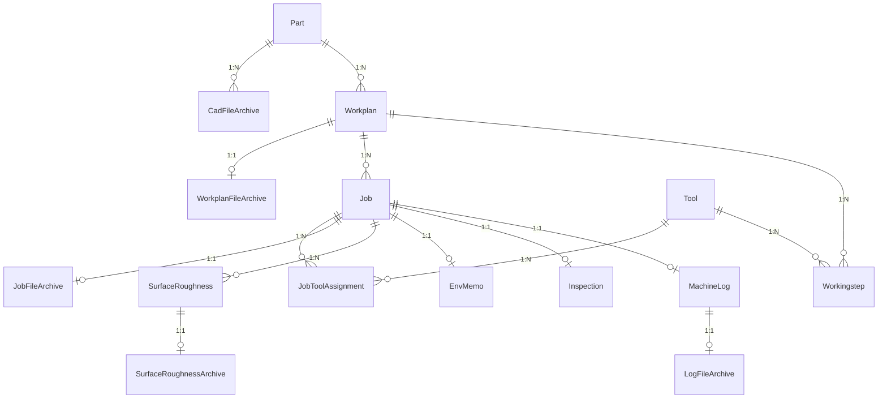

<p align="center">
  
</p>

<h1 align="center">공작기계지능화실험실 통합 제조 데이터베이스 시스템 (ManufacturingDB)</h1>

<p align="center">
  <a href="https://www.python.org/"></a>
  <a href="https://www.mysql.com/"></a>
  <a href="https://www.sqlalchemy.org/"></a>
  <a href="https://streamlit.io/"></a>
  <a href="https://www.iso.org/"></a>
  <a href="https://github.com/OrcusExtreme/ManufacturingDB"></a>
</p>

공작기계지능화실험실(Machine Tool Intelligence Lab)의 **통합 제조 데이터베이스 및 가공 데이터 분석 시스템**입니다.  
공작기계(CNC) 가공 과정에서 발생하는 이기종 데이터(NC 프로그램, 12.8kHz 고주파 NI TDMS 센서·CNC 데이터, 10Hz 장비 로그, 표면 조도 프로파일 CSV, 3D CAD 모델)를 Watchdog 기반으로 자동 감시·수집·파싱하여 **ISO 14649(STEP-NC) 표준 기반 RDBMS**에 정규화 적재하고, 분석용 웹 대시보드와 외부 연동용 REST API를 제공합니다.
가공 요약(가공 시작·종료, 절삭시간, 이동거리, 완료 여부)은 **TDMS + NC 두 파일**로 계산하며, 장비 로그는 장비 계산값을 남길 때만 쓰는 선택 입력입니다. 장비가 수집 폴더에 넣는 XML 메타데이터는 보관하고 빈 칸만 보충합니다.

---

## 주요 기능

### 1. ISO 14649(STEP-NC) 표준 기반 데이터 모델링
- **정적 공정 계획(Static Planning)과 동적 가공 실행(Dynamic Execution)의 분리 설계**
- `Part(부품)` ➔ `Workplan(NC 가공계획)` ➔ `Workingstep(단위공정: 가공 형상 · 공정 · 절삭조건 · 공구 단위)` ↔ `Tool(공구 마스터)` 구조의 계층형 공정 모델링
- **ISO 14649 기준 단위 공정(Workingstep) 분리**: 가공 형상 · 공정(황삭/정삭)과 전략 · 절삭조건(S·F) · 공구가 같은 이어진 절삭 패스를 한 행으로. 가공 형상은 실제 공구 지름으로 깎인 자리를 소재 격자(Z-map)로 따라가 판별(한 덩어리로 판 패스들 = 한 형상)하고, 형상 분류(slot · step · planar_face · closed/open_pocket · round_hole — 부품의 소재 크기로 둘레의 벽 · 열림을 보고 판단, 소재 크기가 없으면 기록하지 않음)·크기, 축방향/반경 절입(ap·ae), 제거 체적, 패스별 경로(NC 줄 · 위치)를 자동 추출 ([분리 규칙](#4-워킹스텝-분리-규칙-nc))
- 동일 Workplan 조건에서 반복 수행되는 실험 가공 차수(`Job`)의 1:N 이력 관리

### 2. 가공 차수별 공구 지정 및 환경 데이터 자동 수집
- **Job별 실제 사용 공구 지정 (`job_tool_assignment`)**:
  - 가공 차수마다 실제 매거진 포트 또는 미장착 재고에서 사용된 공구를 T번호 기준으로 매핑
  - 지정 당시의 공구 제원 스냅샷을 영구 보존하여 공구 마스터 전체 교체 또는 매거진 포트 재배치 시에도 과거 가공 데이터 불변성 보장
  - NC 파일 업로드 시 즉시 T번호 파싱 프리뷰 제공 및 공구 지정 (Job 워크스페이스에서는 사용 공구 제원 조회)
- **가공 시각 외기 온습도·날씨 자동 기록 (`weather_service`)**:
  - 온습도 수기 입력이 누락된 Job에 대해 가공 시작 시각 기준 기상 모델 격자 데이터(Open-Meteo Historical Weather API)를 1시간 주기로 자동 조회 및 보충
  - 안정적 관측 데이터 확보를 위해 12시간 지연 수집 및 출처(`weather_source`), 기준 시각(`weather_time`) 명시

### 3. 스토리지 계층 구조 및 백업 체계
- **MySQL RDBMS**: B-Tree 인덱스 기반 조건 검색, 다차원 조인 및 통계 쿼리 처리
- **Apache Parquet**: 12.8kHz 고주파 시계열 센서 데이터 및 단면 표면조도 곡선을 Snappy 컬럼형 압축 포맷으로 저장 및 시각화
- **File Vault**: 원본 파일의 무결성 보존을 위한 디렉터리 분리 (프로젝트 외부 경로 지정을 통해 소스 변경 시에도 백업 격리)
- **LONGBLOB 이중화**: 덤프 파일 단독 복구를 위해 15MB 이하 주요 원본 파일(XML, NC, CAD 등)을 DB 내 바이너리로 이중 보관
- **초기화 시 보관소 격리**: 데이터베이스 및 런타임 데이터 초기화 시 백업 보관소(`archive_vault`)는 삭제 대상에서 제외

### 4. 실시간 자동 수집 파이프라인
- `machining_raw_data/` 디렉터리 내 신규 파일 유입 시 파일 락(Lock) 해제를 감지하여 자동 파싱 트리거 (Watchdog)
- 자료 유형별 파서 자동 분기 (`XML`, `TDMS`, `NC`, `Log`, `CSV`, `STEP`/`STL`)
- **디렉터리 자동 정돈**: 수집 폴더 내 투입된 파일을 확장자 규칙에 따라 `XML/`, `Log/`, `TDMS/`, `NC/` 하위 디렉터리로 자동 분류 (`backend/job_layout.py`)
- **TDMS 파싱 최적화**: 메모리 가용량 기반의 단일 패스(Single-pass) 읽기와 지연 로딩 전환을 통해 대용량 센서 파일 파싱 속도 개선
- 백그라운드 변환 데몬(`tdms_visualizer.py`)을 통한 시간 도메인 지표 및 FFT 주파수 스펙트럼 Parquet 자동 생성

### 5. 제조 DB Controller (Win32 GUI)
- `system_controller.exe`를 통해 4대 서브프로세스(Streamlit 대시보드, Watchdog 수집기, TDMS 변환기, REST API 서버)의 통합 제어 및 실시간 로그 스트리밍 지원
- 프로세스 재시작 없이 파서 활성화/비활성화 및 파이프라인 일시정지 제어 (`backend/pipeline_config.json`)
- Windows Job Object 기반 프로세스 그룹 관리로 컨트롤러 비정상 종료 시 자식 프로세스 자동 회수
- 외부 스크립트 실행 방식으로 구성되어 파이썬 소스 수정 시 컨트롤러 재컴파일 불필요
- 사용자 관리(가입 승인/거절, 계정 조회/삭제) 및 스토리지 선택적 초기화 GUI 내장

### 6. Streamlit 기반 웹 통합 대시보드 (Port 8501)
- 가공 차수(Job) 다차원 필터링 및 상세 분석 (Plotly 기반 센서 Envelope, FFT, 3D CAD Z-up 뷰어, 표면조도 프로파일, 실제 사용 공구 현황)
- 데이터 수동 업로드, 메타데이터/가공환경/품질검사/사용공구 매핑 입력 일원화
- ISO 14649 공정 트리 조회 및 공구 마스터(장착/미장착) 일괄 관리
- 인터랙티브 ERD 기반 테이블 탐색기 및 데이터 드릴다운 ZIP 다운로드 지원
- PBKDF2-HMAC-SHA256 해시 기반 로컬 인증 및 세션 영속화

### 7. 제조 DB REST API 서버 (Port 8000)
- 외부 시스템, 연계 분석 장비 및 AI/LLM 파이프라인 연동을 위한 FastAPI 기반 RESTful 서비스
- **전체 데이터 익스포트 (`GET /api/v1/export/all`)**: 15개 테이블의 전체 가공 및 계측 데이터를 단일 JSON으로 추출
- **계층형 프로필 조회 (`GET /api/v1/jobs/{job_id}/full`)**: 공정 계획, 공구 매핑, 로그, 조도, 품질 데이터를 계층 구조의 단일 컨텍스트로 제공
- **OpenAPI / Swagger UI (`http://localhost:8000/docs`)**: 인터랙티브 API 문서 및 스키마 명세 지원

---

## 시스템 아키텍처

제조 DB Controller(`system_controller.exe`)를 통해 4개의 독립 백그라운드 프로세스를 관리합니다. 각 프로세스는 직접적인 프로세스 간 통신(IPC) 대신 데이터베이스와 파일 시스템을 통해 상호 연동됩니다.

```text
┌─────────────────────────────────────────────────────────────────────────────────────────────┐
│  제조 DB Controller  (system_controller.exe · C++ Win32)                                     │
│  · 4대 서브프로세스 기동/중지 · 실시간 통합 로그 · 파서별 활성화 설정 · 일시정지              │
│  · backend/pipeline_config.json (설정 파일 기반 상태 동기화)                                  │
│  · Windows Job Object 기반 자식 프로세스 생명주기 관리                                       │
└────────┬─────────────────────────┬──────────────────────────┬───────────────────────────────┤
         │ 프로세스 제어            │ 프로세스 제어             │ 프로세스 제어                 │ 프로세스 제어
         ▼                         ▼                          ▼                               ▼
  ① Watchdog 수집기         ② TDMS 변환 데몬            ③ Streamlit 대시보드            ④ REST API 서버
                               (5초 폴링)                   (localhost:8501)               (0.0.0.0:8000)

[가공/계측 데이터 투입]
         │
         ▼
   data/machining_raw_data/{Project}/{Part}/
        ├─ CAD_Files/                      ← Part 수준 3D 도면 파일
        └─ {JobID}/ XML · Log · TDMS · NC · Surface_Roughness · etc · processed_parquet
                                          │
                                          ▼
 ① Watchdog 수집기  (data_insert_recognization.py)
    ├─ 파일 안정성 검사 (File Lock 해제 감지)
    ├─ job_layout.py — 확장자 기반 하위 디렉터리 자동 분류
    ├─ pipeline_control.py — 파서 활성화 상태 및 일시정지 플래그 확인
    ├─ 파싱 엔진 [parsers/]
    │    xml · nc · tdms · log · roughness · cad  (+ job_manager · tool_inserter · tool_assignment)
    ├─ weather_service — 1시간 주기 미기록 Job 외기 온습도·날씨 자동 보충 (Open-Meteo)
    ├─ integrity_monitor — 30분 주기 백그라운드 SHA-256 무결성 검증
    └─ 오류 격리 ─▶ data/failed_data (DLQ)
         │
         ├──▶ MySQL RDBMS (SQLAlchemy ORM)   15개 테이블 정규화 데이터 적재
         ├──▶ Archive Vault                  원본 파일 보관소 (프로젝트 외부)
         └──▶ MySQL LONGBLOB                 주요 메타/형상 원본 파일 (15MB 이하)

 ② TDMS 변환 데몬  (tdms_visualizer.py)
    └─ tdms_alignment.py — NC 블록 대조 실가공 구간 판별 및 시간축 정렬, FFT 계산
         ├──▶ Parquet 스토리지
         │      data/processed_data → Job 디렉터리/processed_parquet → Vault
         └──▶ MySQL 메타데이터 업데이트 (tdms_parquet_path, machining_window)

 ③ Streamlit UI (:8501)
    ├─ Read  ◀── MySQL · Parquet 스토리지 · Archive Vault · 원본 디렉터리
    ├─ Write ──▶ MySQL (메타데이터 수정, Cascade 삭제, 공구 마스터 갱신, Job 공구 매핑)
    ├─ Write ──▶ raw_data (수동 데이터 삽입 → 수집기 파이프라인 재진입)
    └─ recovery_engine.py ──▶ 복구 ZIP 생성 및 로컬 복원

  ※ 데이터베이스에는 보관소 루트 기준의 상대 경로만 저장되며,
     실제 파일 I/O는 파서, 복구 엔진 및 대시보드 컴포넌트가 파일 시스템을 통해 수행합니다.
```

---

## 데이터베이스 스키마 구조 (ISO 14649)



| 도메인 | 테이블명 | 설명 |
| :--- | :--- | :--- |
| **마스터 & 공정 계획** | `part`, `workplan`, `tool`, `workingstep`, `cad_file_archive` | 부품 마스터, NC 공정 계획(부품·프로그램·NC해시 복합 유니크 제약), 공구 제원(ISO 14649 분류 및 치수, 매거진 장착/재고 관리), 단위 공정 순서 및 ISO 14649 근거(가공 형상·공정·전략·Feed/Spindle·축방향/반경 절입·패스별 경로), 3D 형상 파일 관리 |
| **가공 실행 & 품질** | `job`, `job_tool_assignment`, `machine_log`, `surface_roughness`, `inspection`, `env_memo` | 가공 차수 이력(가공 시간, 거리, 에러), Job별 실제 사용 공구(T번호 → 공구 마스터, 지정 당시 제원 스냅샷 보존), CNC 1Hz 부하 통계, 다지점 표면조도 프로파일, 치수공차 판정(PASS/FAIL), 온습도(수기 입력 및 외기 자동 수집)·날씨(`weather`, `weather_source`, `weather_time`)·가공 환경 데이터 |
| **아카이브 & 백업** | `workplan_file_archive`, `job_file_archive`, `surface_roughness_archive`, `log_file_archive` | 원본 디렉터리 경로(`*_raw_path`) 및 LONGBLOB 백업 데이터 |

- 원본 파일 경로는 메타데이터 테이블(`job`, `workplan` 등)과 분리하여 아카이브 테이블(`*_archive`)에서 관리합니다.
- 보관소(`archive_vault`)는 원본 디렉터리(`machining_raw_data`)의 상대 경로 구조를 그대로 유지하므로, DB에는 보관소 내부 절대 경로를 저장하지 않고 상대 경로 규칙(`backend/vault_layout.py`)에 따라 조회합니다.
- 파일 조회 및 복원 시 `로컬 원본 경로 ➔ 백업 보관소 ➔ DB 바이너리(BLOB)` 순서의 폴백(Fallback) 구조를 지원합니다.

---

## 디렉터리 구성

```text
ManufacturingDB/
├── system_controller.exe             # 통합 GUI 제어기 (제조 DB Controller)
├── README.md
├── .env                              # 데이터베이스 접속 및 환경 변수 설정
├── .streamlit/config.toml            # Streamlit 서버 설정
├── pyrefly.toml                      # 타입 체커 설정
│
├── assets/                           # 정적 이미지 및 아이콘 자산
│   ├── logo_card.png                 #   컨트롤러 헤더 및 사이드바 카드 로고
│   ├── logo.png / logo.jpg           #   메인 로고
│   └── logo.ico / favicon.ico        #   애플리케이션 및 브라우저 파비콘
│
├── controller/                       # C++ Win32 GUI 소스 코드
│   ├── system_controller.cpp         #   UI 이벤트 및 프로세스 관리 구현
│   ├── theme.h                       #   UI 테마 및 드로잉 헬퍼
│   ├── app_config.h                  #   설정 JSON 입출력 및 파이썬 경로 탐색
│   └── system_controller.rc          #   리소스 명세 (아이콘, 버전 정보)
│
├── backend/                          # 백엔드 및 수집 파이프라인
│   ├── data_insert_recognization.py  #   Watchdog 파일 감시 및 작업 분배기
│   ├── job_layout.py                 #   Job 디렉터리 분류 규칙 (XML, Log, TDMS, NC)
│   ├── vault_manager.py              #   백업 보관소 관리 및 아카이빙 로직
│   ├── vault_layout.py               #   보관소 내부 경로 산출 규칙
│   ├── file_archive.py               #   아카이브 레코드 조회 및 생성
│   ├── job_manager.py                #   Job 레코드 생성 및 검증
│   ├── tool_assignment.py            #   Job별 사용 공구 지정 및 제원 스냅샷 관리
│   ├── weather_service.py            #   가공 시각 외기 온습도·날씨 자동 기록 데몬 (Open-Meteo)
│   ├── recovery_engine.py            #   보관소 및 DB 기반 복원 엔진
│   ├── recompute_job_summary.py      #   기존 Job 가공 요약을 TDMS+NC 기준으로 재계산 (미리보기 / --apply)
│   ├── resync_workingsteps.py        #   기존 워킹스텝을 ISO 14649 분리 규칙으로 NC 에서 다시 나눔 (미리보기 / --apply)
│   ├── compare_xml_tdms.py           #   장비 XML 값 대 TDMS+NC 계산값 비교표 (읽기 전용, CSV 저장)
│   ├── tdms_visualizer.py            #   TDMS Parquet/FFT 변환 백그라운드 데몬
│   ├── tdms_alignment.py             #   NC 블록 대조 가공 구간 판별, 실행 사이클(가공 시작·종료), UTC→KST 시간축 정렬
│   ├── tool_inserter.py              #   ISO 14649 공구 마스터 검증 및 일괄 적재 (스냅샷 기반 재연결)
│   ├── pipeline_control.py           #   파이프라인 상태 제어 인터페이스
│   ├── pipeline_config.json          #   파서 활성화 및 일시정지 상태 설정 파일
│   ├── integrity.py                  #   SHA-256 기반 원본 무결성 검증
│   ├── integrity_monitor.py          #   백그라운드 무결성 모니터링 데몬 (30분 주기)
│   ├── auth.py                       #   PBKDF2 기반 계정 인증 및 세션 관리
│   ├── user_manager.py               #   사용자 관리 독립 GUI (tkinter)
│   ├── clean_dummy_data.py           #   미참조 레코드 정리 유틸리티
│   ├── reset_database_and_storage.py #   데이터베이스 및 스토리지 선택적 초기화 CLI
│   ├── reset_manager.py              #   초기화 선택 GUI (tkinter)
│   ├── admin_ui.py                   #   관리 GUI 공통 컴포넌트
│   ├── migrate_*.py                  #   스키마 및 디렉터리 구조 마이그레이션 스크립트
│   ├── normalize_name_casing.py      #   디렉터리 대소문자 표준화 도구
│   ├── DB/
│   │   ├── database.py               #   SQLAlchemy 엔진 및 세션 설정
│   │   ├── models.py                 #   ORM 스키마 정의 (15개 테이블)
│   │   ├── schema_patch.py           #   기동 시 스키마 테이블/컬럼 자동 보정 패치
│   │   └── sync_column_comments.py   #   models.py 주석을 운영 DB 컬럼·표 주석에 반영 (미리보기 / --apply)
│   ├── parsers/                      #   자료 유형별 파서
│   │   ├── xml_parser.py  nc_parser.py  tdms_parser.py
│   │   ├── nc_geometry.py            #   소재 격자(Z-map)로 가공 형상 · 절입(ap·ae) · 황삭/정삭 판별
│   │   └── log_parser.py  roughness_parser.py  cad_parser.py
│   ├── api/                          #   FastAPI REST API 서비스
│   │   ├── main.py                   #   API 앱 진입점 및 lifespan 스키마 보정
│   │   ├── serializers.py            #   데이터 직렬화 (스냅샷 공구·절삭조건·날씨 포함)
│   │   └── routers/                  #   jobs, parts, export 라우터
│   └── tests/                        #   단위 테스트 및 시스템 통합 검증 스크립트
│       ├── fixtures/                 #   실측 NC 파일 검증 데이터 (O0911, O1110, O0912 EDGECAM)
│       ├── test_nc_parser.py         #   워킹스텝 분리 규칙 및 절삭조건 파싱 테스트
│       ├── test_nc_workingstep_sync.py # NC 기준 워킹스텝 재구성 및 동기화 무결성 테스트
│       ├── test_resync_workingsteps.py # 기존 워킹스텝 다시 나누기 (미리보기·반영·백업·설치 확인 알림) 테스트
│       ├── test_tool_assignment.py   #   Job별 공구 지정 및 마스터 교체 후 매칭 테스트
│       ├── test_weather_service.py   #   외기 온습도·날씨 자동 기록 단위 테스트
│       ├── test_tdms_cycle.py        #   TDMS 실행 사이클·가공 프로그램·가공 요약 기록 규칙 테스트
│       ├── test_nc_program_info.py   #   NC 프로그램명·절삭 경로 길이 테스트
│       ├── test_machine_log_sources.py # CNC 요약 출처(TDMS/로그)·장비 계산값·기존 Job 재계산 테스트
│       ├── test_part_material.py     #   부품 소재 입력·표기 통일·XML 비어 있을 때만 채움 테스트
│       ├── test_two_file_inputs.py   #   TDMS 가공 프로그램 읽기·NC 비교·재판별 조건·시작 보정 규칙 테스트
│       ├── test_pipeline_two_files.py # 합성 TDMS+NC 수집 흐름 전체 회귀 테스트 (도착 순서·중단·불일치·늦은 XML)
│       ├── test_compare_xml_tdms.py  #   XML 대 TDMS 비교표 판정 테스트
│       ├── test_sync_column_comments.py # 운영 DB 주석 반영 계획·DDL 테스트
│       ├── test_release_version.py   #   배포 판 번호(README·대시보드·컨트롤러) 일치 검사
│       └── verify_e2e_cutting_conditions.py # 절삭조건 E2E 데이터베이스 연동 검증
│
├── frontend/                         # Streamlit 웹 대시보드
│   ├── dashboard.py                  #   대시보드 메인 진입점
│   ├── cad_viewer_component.py       #   Three.js 기반 3D CAD(STEP/STL) 뷰어
│   ├── erd_component.py              #   인터랙티브 ERD 컴포넌트
│   └── components/                   #   화면별 서브 컴포넌트
│       ├── home_view.py              #   홈 대시보드 화면
│       ├── filters.py                #   다단계 검색 필터
│       ├── job_workspace.py          #   Job 상세 분석 및 관리 화면 (사용 공구 제원 조회)
│       ├── master_tree.py            #   ISO 14649 공정 계층 트리뷰 (형상, Roughing/Finishing, 전략, 공구, RPM, mm/min, ap·ae, NC 줄)
│       ├── tool_master.py            #   공구 마스터 조회 및 파일 교체
│       ├── tool_picker.py            #   T번호별 공구 선택 및 Job 사용 공구 현황 공용 컴포넌트
│       ├── data_upload.py            #   수동 데이터 업로드 화면 (NC 즉시 분석 및 공구 지정)
│       ├── db_explorer.py            #   DB 테이블 조회 및 편집기
│       ├── download_center.py        #   데이터 일괄 다운로드 센터
│       └── recovery.py               #   백업 생성 및 시스템 복원
│
├── data/                             # 런타임 저장 디렉터리 (Git 추적 제외)
│   ├── machining_raw_data/           #   가공 데이터 감시 디렉터리
│   ├── processed_data/               #   전처리된 Parquet 시계열 데이터
│   └── failed_data/                  #   파싱 실패 격리 디렉터리 (DLQ)
│
├── tools/                            # 개발 및 운영 유틸리티
│   ├── run_system.py                 #   통합 프로세스 일괄 기동 CLI
│   ├── run_api.py / run_api.bat      #   REST API 서버 단독 실행
│   ├── compile_controller.bat        #   C++ 컨트롤러 빌드 스크립트
│   ├── run_controller.bat            #   컨트롤러 실행 스크립트
│   ├── run_windows.bat               #   가상환경 구성 및 통합 실행 배치 파일
│   ├── recompute_jobs.bat            #   업그레이드 뒤 기존 데이터 갱신: 워킹스텝 다시 나누기 · Job 가공 요약 재계산 (각각 미리보기 → 확인 → 반영)
│   └── requirements.txt              #   파이썬 의존성 패키지 명세
│
├── installer/                        # 배포 패키지(Inno Setup) 빌드 환경
│   ├── build_installer.py            #   설치 패키지 빌드 자동화 스크립트
│   ├── ManufacturingDB.iss           #   Inno Setup 스크립트
│   ├── setup_target.py               #   설치 후 초기 구성 스크립트
│   └── requirements-runtime.txt      #   배포용 동봉 파이썬 패키지 명세
│
└── docs/                             # 기술 문서 및 표준 데이터
    ├── gemini.md                     # 시스템 아키텍처 상세 기술 명세
    ├── tool_iso14649.csv             # 공구 마스터 초기 표준 데이터
    ├── tool_iso14649_schema.sql      # Tool 테이블 DDL 스키마
    └── tool_iso14649_sources.md      # 공구 제원 출처 및 실물 대조 문서
```

---

## 시작하기

> **참고**: 배포 대상 장비에 전체 환경을 일괄 구축하려면 [배포용 설치 패키지](#배포용-설치-패키지-setupexe)를 사용할 수 있습니다. 아래 가이드는 개발 환경 설정 기준입니다.

### 1. 요구 사항
- **Python**: 3.10 이상
- **MySQL**: 8.0 이상
- **OS**: Windows 10 / 11 (C++ Win32 컨트롤러 구동 환경)
  - 타 OS 환경에서는 CLI 기반 실행(`python tools/run_system.py`)을 지원합니다.
- **g++ (MinGW-w64 / w64devkit)**: 컨트롤러 C++ 소스 재컴파일 시 필요

### 2. 저장소 복제 및 가상환경 설정
```bash
git clone https://github.com/OrcusExtreme/ManufacturingDB.git
cd ManufacturingDB

# 가상환경 생성 및 패키지 설치
python -m venv .venv
.venv\Scripts\activate
pip install -r tools/requirements.txt
```

### 3. 환경 변수 설정 (`.env`)
프로젝트 루트 디렉터리에 `.env` 파일을 생성하고 데이터베이스 및 스토리지 경로를 설정합니다.

```env
DB_HOST=localhost
DB_PORT=3306
DB_USER=root
DB_PASSWORD=your_password
DB_NAME=orcus
PYTHONPATH=backend

# 원본 백업 보관소 외부 경로 지정 (권장)
ORCUS_VAULT_ROOT=D:\Orcus\archive_vault

# (선택) 가공 시각 외기 온습도·날씨 자동 기록 설정 (기본값: 활성화, 창원시 마산합포구 기준)
# WEATHER_AUTOFILL=1
# WEATHER_LATITUDE=35.1702
# WEATHER_LONGITUDE=128.5728
# WEATHER_PLACE_NAME=창원시 마산합포구
```

#### 원본 백업 보관소 외부 지정 정책
프로젝트 디렉터리 재설치나 코드 변경 시에도 수집된 원본 데이터의 보존성을 확보하기 위해, 백업 보관소(`archive_vault`)는 프로젝트 외부 디렉터리로 분리 지정하는 것을 권장합니다.

| 우선순위 | 환경 변수 | 설명 |
| :--- | :--- | :--- |
| 1 | `ORCUS_VAULT_ROOT` | 백업 보관소 절대 경로 직접 지정 |
| 2 | `ORCUS_DB_DATA_DIR` | 지정된 경로 하위의 `archive_vault/` 디렉터리 사용 |
| 3 | (미지정) | 기본 내부 경로 `data/archive_vault` 사용 |

기존 보관소 디렉터리 이전 시 아래 마이그레이션 스크립트를 사용할 수 있습니다.

```bash
python backend/migrate_vault_location.py            # 변경 예정 내역 미리보기
python backend/migrate_vault_location.py --apply    # 실제 이동 적용 (복사 ➔ 검증 ➔ 원본 정리)
```

> ⚠️ **주의**: 백업 보관소를 MySQL 데이터 디렉터리 내부(예: `.../Data/orcus`)로 설정하지 마십시오. 데이터베이스 삭제(`DROP DATABASE`) 시 스키마 디렉터리 전체가 제거되어 보관소 데이터가 함께 유실될 수 있습니다. 반드시 별도의 디렉터리 경로를 지정하십시오.

### 4. 시스템 실행

#### 방법 1: 제조 DB Controller 실행 (권장)
```bash
system_controller.exe          # 실행 파일 직접 실행
# 또는
tools\run_controller.bat       # 실행 파일 부재 시 자동 컴파일 후 실행
```
- Win32 네이티브 컨트롤러를 통해 Streamlit UI, 수집 파이프라인, TDMS 변환기, REST API 서버의 개별 시작/중지 및 통합 로그 모니터링을 지원합니다.
- 컨트롤러 메뉴의 `유저 관리`에서 대시보드 회원가입 요청의 승인/거절 및 계정 관리를 수행할 수 있습니다 (`backend/user_manager.py`).

*컨트롤러 수정 후 재빌드 (MinGW g++ 필요):*
```bash
tools\compile_controller.bat
```

#### 방법 2: CLI 터미널 일괄 실행
```bash
python tools/run_system.py
```

*개별 서비스 단독 실행:*
```bash
# REST API 서버 단독 실행 (Port 8000)
tools\run_api.bat              # 또는 python tools/run_api.py

# 가공 시각 외기 온습도·날씨 자동 보충 수동 실행
python backend/weather_service.py
```

*관리 도구 (모두 기본은 미리보기·읽기 전용):*
```bash
# 장비 XML 이 보관된 Job 의 XML 값 대 TDMS+NC 계산값 비교표 (DB 를 바꾸지 않음)
python backend/compare_xml_tdms.py [Job 번호 ...] [--csv 표.csv]

# 기존 Job 가공 요약을 TDMS+NC 기준으로 다시 계산 (--apply 로 반영, 변경 전 값은 backups/)
python backend/recompute_job_summary.py [Job 번호 ...] [--all] [--apply]

# models.py 의 컬럼·표 주석을 운영 DB 에 반영 (DB 탐색기의 '설명' 칸, --apply 로 반영 · 반영 뒤 칸 정의가 그대로인지 확인)
python backend/DB/sync_column_comments.py [--apply]
```

### 5. 서비스 접속 정보
- **통합 웹 대시보드**: [http://localhost:8501](http://localhost:8501)
- **REST API Swagger 문서**: [http://localhost:8000/docs](http://localhost:8000/docs) (ReDoc: `/redoc`, OpenAPI 스펙: `/openapi.json`)
- **컨트롤러 대시보드**: `system_controller.exe` 창을 통해 4개 서브프로세스 상태 및 로그 확인

---

## 배포용 설치 패키지 (Setup.exe)

타 장비(작업장 PC, 계측 서버 등)에 별도의 파이썬 및 MySQL 설치 없이 일괄 배포할 수 있는 인스톨러 빌드 환경(`installer/`)을 제공합니다.

### 1. 패키지 설치 절차 (배포 대상 PC)
1. 생성된 `Setup_ManufacturingDB_v*.exe`를 관리자 권한으로 실행합니다.
2. **설치 디렉터리**(기본값: `D:\ManufacturingDB`)와 **데이터 디렉터리**(기본값: `D:\Orcus`)를 지정합니다.
3. 데이터베이스 모드를 선택합니다:
   - **동봉된 MySQL 8.0 설치**: 전용 윈도우 서비스(`OrcusMySQL`)로 자동 등록 및 설정됩니다.
   - **기존 MySQL 인스턴스 연동**: 기설치된 MySQL 8.0 인스턴스의 포트와 root 계정 정보를 입력하여 연동합니다.
4. 설치 완료 후 생성된 바탕화면 바로가기 또는 `system_controller.exe`를 실행하고 **[전체 시작]**을 클릭합니다.
5. 웹 대시보드 접속 후 계정 가입 신청을 진행하고, 컨트롤러의 **[유저 관리]** 창에서 해당 계정을 승인합니다.

### 2. 설치 패키지 빌드 (개발 PC)
Inno Setup 6 및 로컬 MySQL 8.0 서버가 구성된 환경에서 아래 스크립트를 통해 단일 설치 파일을 빌드할 수 있습니다.

```bat
python installer\build_installer.py           # dist/Setup_ManufacturingDB_v*.exe 생성
python installer\build_installer.py --test    # 로컬 테스트용 경량 빌드
```

- 판 번호는 이 문서 릴리즈 노트 맨 위(`### [Vx.y.z]`)를 씁니다. 판을 올릴 때는 README 배지, 대시보드 사이드바(`frontend/dashboard.py`), 홈 화면(`frontend/components/home_view.py`), 컨트롤러 버전 정보(`controller/system_controller.rc`)도 함께 고칩니다 — 하나라도 다르면 정식 판은 만들지 않습니다 (`backend/tests/test_release_version.py` 도 같은 것을 봅니다).
- 결과물은 `dist/` 에 설치 파일과 SHA-256(`.sha256`)이 함께 생깁니다. 커밋하지 않은 새 파일도 담기므로(.gitignore 대상 제외), 배포한 판은 같은 내용으로 커밋해 둡니다.

### 3. 업그레이드 (예전 판에서 올리기)
1. 컨트롤러에서 **[전체 중지]** 를 누른 뒤 새 `Setup_ManufacturingDB_v*.exe` 를 관리자 권한으로 실행합니다. 지난 설치의 폴더·MySQL·DB 설정을 그대로 쓰고, 데이터·`.env`·파서 On/Off 설정은 그대로 둔 채 프로그램만 바꿉니다.
2. 설치 마무리 단계가 DB 를 새 판에 맞춥니다: 빠진 테이블·컬럼 추가(`schema_patch`), 컬럼·표 설명 맞춤(주석만 변경, 칸 정의는 그대로 — 바꾼 설명은 예전 값과 함께 기록), 설치 확인. 기록은 `{설치 폴더}\logs\install.log` 입니다.
3. 이미 쌓인 데이터(워킹스텝, Job 가공 요약)는 설치가 바꾸지 않습니다. 지금 규칙으로 맞추려면 서비스가 멈춘 상태에서 `{설치 폴더}\tools\recompute_jobs.bat` 를 실행합니다. 두 단계를 차례로 보여 줍니다:
   1. **워킹스텝 다시 나누기** (V3.3.2 규칙, `backend/resync_workingsteps.py`): 가공 형상 · 공정 · 절삭조건 · 공구로 다시 나누고 형상 · 절입 · 패스 정보를 채웁니다. 공구 순서가 같은 Workplan 은 값만 채우고(행 유지), NC 원본이 없는 Workplan 은 그대로 둡니다. `operation_type` 은 NC 가 정한 ISO 14649 공정으로 바뀝니다 (예전에 사람이 적은 값은 백업에 남음).
   2. **Job 가공 요약 재계산** (V3.3.0 기준, `backend/recompute_job_summary.py`): TDMS+NC, 위치 점프를 뺀 총 이동거리.

   단계마다 미리보기를 보여 준 뒤 **Y** 를 누를 때만 반영하고, 바꾸기 전 값은 `backups\` 에 남깁니다. 설치 확인 단계가 이렇게 바꿀 Workplan·Job 수를 `install.log` 에 알립니다.

---

## 대시보드 주요 기능 안내

1. **홈 화면**: 시스템 상태 요약 및 주요 기능에 접근할 수 있는 바로가기 그리드를 제공합니다.
2. **Job 워크스페이스**:
   - 프로젝트, 부품, 가공차수, 실험일자, 장비 기준의 5단계 캐스케이딩 필터를 통한 가공 데이터 검색
   - 시간 도메인 Envelope, 주파수 FFT 스펙트럼, CNC 채널 추이(TDMS·장비 로그), 단면 표면조도 프로파일 시각화
   - NC 파일의 프로그램과 TDMS 에서 가공한 프로그램이 다르면 'TDMS 그래프' 카드에 경고
   - `사용 공구 제원` 카드: 이 Job 에서 쓴 공구의 제원 조회 (공구 지정은 업로드 화면에서)
   - 불필요 가공 데이터 삭제 시 하위 연관 레코드의 원자적 연쇄 삭제(`CASCADE`) 지원
3. **계층형 마스터 데이터**:
   - ISO 14649 기반 공정 계층(`Part ➔ Workplan ➔ Workingstep ➔ Tool`) 탐색
   - Part 마다 소재 크기(`121 × 101 × 28 mm (origin: corner)`, 없으면 형상 분류를 기록하지 않는다는 안내)
   - 단위 공정별 형상 번호 · 가공 형상(DB 원문 `slot` 등)과 크기(`W20 × L101 × D2`) · 공정(`Roughing` / `Finishing` / `Drilling` 등) · 전략(DB 원문) · 공구(`T06 · ENDMILL · Ø12 · 3 flutes` 한 칸) · 절삭 조건(RPM, mm/min) · 축방향/반경 절입 · 패스 수 · NC 줄 · 절삭 길이 · 제거 체적, Part별 3D CAD(STEP/STL) 뷰어 지원
   - 공정 칸은 ISO 14649 처럼 정삭 스텝이 따로 없는 형상의 밀링 스텝을 `Finishing` 으로 보임 (정삭 스텝이 있는 형상만 앞 스텝이 `Roughing`). DB 의 `operation_type` 값은 그대로
4. **공구 마스터 관리**:
   - ISO 14649 규격 기반 공구 제원(치수, 날 수, 재질, 장착 상태) 관리
   - 표준 CSV 템플릿 다운로드 및 수정본 업로드를 통한 공구 마스터 일괄 갱신
   - 공구 마스터 전체 교체 시에도 기존 가공 차수(Job)의 공구 매핑은 지정 당시의 제원 스냅샷을 기반으로 자동 재연결
5. **데이터 삽입 (수동 업로드)**:
   - 3D 형상 모델, TDMS·NC(필수), 장비 로그·표면조도 CSV(선택) 웹 수동 업로드 인터페이스 — 새 Job 은 TDMS 와 NC 가 모두 있어야 생성
   - TDMS 를 고르면 CNC-ProgramName 채널에서 실제로 가공한 프로그램을 읽어 올리는 NC 와 비교·경고 (기록 시작 때 프로그램이 남는 파일명은 쓰지 않음)
   - Part 행에서 소재와 함께 **소재 크기(X · Y · Z mm)와 공작물 원점**(윗면 모서리 / 윗면 가운데) 입력 — 워킹스텝 가공 형상 분류에 쓰며, 저장하면 그 부품의 기존 워킹스텝을 다시 판단 (`소재 정보만 저장`). 비워 두면 형상 분류 · 크기 · 제거 체적 · 반경 절입은 기록하지 않음
   - NC 파일 선택 즉시 T번호, 공구별 스텝 수, S/F 조건 범위 프리뷰 제공 및 공구 마스터(장착/미장착 재고) 매핑 지원
   - 업로드 시점에 가공 분류, 환경 데이터(온습도, 작업자, 이상 소음 등), 품질 점검(치수공차, 합불 판정) 동시 입력
   - 온습도 미입력 시 가공 시작 시각 기준 기상 모델 격자 데이터 자동 수집 연동
6. **DB 테이블 탐색기**:
   - 인터랙티브 ERD 연동 테이블 실시간 조회, 다중 조건 필터링, 컬럼 정렬 및 CSV 내보내기
   - 데이터 무결성 보호를 위해 테이블 직접 수정 시 관리자 인증 절차 적용
7. **데이터 다운로드 센터**:
   - 프로젝트 및 가공 차수 단위의 계층형 선택 및 ZIP 일괄 압축 다운로드
   - 원본 디렉터리 내 파일 누락 시 백업 보관소 및 DB 아카이브 자동 폴백 지원
8. **백그라운드 무결성 모니터링**:
   - 수집 파이프라인 구동 중 30분 주기로 주요 원본 파일의 SHA-256 해시를 재계산하여 데이터 무결성을 검증합니다 (`backend/integrity_monitor.py`).

---

## 세부 기술 규격

### 1. 가공 시각 외기 온습도·날씨 자동 기록 (Weather Service)
데이터 수집 파이프라인 구동 시 1시간 주기로 온습도 및 날씨 정보가 누락된 Job을 탐색하여 자동 보충합니다 (`backend/weather_service.py`).

- **보충 정책**: 수동 업로드 시 사용자가 입력한 온습도는 절대 덮어쓰지 않으며, 비어 있는 항목만 보충합니다.
- **실측/예보 분리**: 가공 당일 예보 데이터가 섞이는 것을 방지하기 위해 가공 시작 시각 기준 **12시간이 경과한 후**에 안정화된 기상 데이터를 조회합니다.
- **출처 추적성**: 실측 환경값과 외부 기상 수집값을 구별할 수 있도록 `env_memo.weather_source`에 수집 출처(예: `open-meteo:temperature,humidity,weather`)를 기록하고, 수집 기준 시각(`weather_time`)을 저장합니다.
- **데이터 제공처**: [Open-Meteo](https://open-meteo.com/) Historical Weather API (CC BY 4.0, 비상업 무료, API 키 불필요)를 사용하며 기준 위치는 공작기계지능화실험실 인근(창원시 마산합포구) 기상 모델 격자값입니다.

### 2. Job별 공구 매핑 및 제원 스냅샷 체계 (Job Tool Assignment)
공구 마스터의 교체 및 포트 이동이 과거 가공 이력 데이터에 영향을 주지 않도록 스냅샷 기반의 매핑 구조를 제공합니다 (`backend/tool_assignment.py`).

- **15번째 ORM 테이블 (`job_tool_assignment`)**: 가공 차수(`job_id`), 공구 번호(`tool_number`), 공구 ID(`tool_id`)와 함께 매핑 시점의 공구 제원(이름, 분류, 직경, 유효길이, 전장, 날수 등)을 독립 컬럼으로 스냅샷 저장합니다.
- **마스터 교체 시 불변성**: 새로운 공구 마스터 CSV/XLSX 업로드로 `tool` 테이블이 전체 교체되더라도, 기존 Job의 공구 기록은 T번호가 아닌 **지정 당시의 제원 스냅샷**을 기준으로 새 마스터에서 일치하는 공구를 찾아 재연결합니다. 일치하는 공구가 없더라도 스냅샷 제원은 영구 보존됩니다.

### 3. 가공 요약 계산 규칙 (TDMS + NC)
Job 의 가공 요약은 TDMS CNC 채널(약 27Hz)과 NC 코드로 계산합니다 (`backend/tdms_visualizer.py`, `backend/tdms_alignment.py`, 출처는 `job.summary_source='TDMS'`).

| 항목 | 규칙 |
|---|---|
| 시각 기준 | TDMS 는 UTC → 한국 시간(+9시간)으로 저장 |
| 가공 프로그램 | `CNC-ProgramName` 중 실제로 절삭이 가장 오래 일어난 프로그램 (파일명·채널 속성은 기록 시작 때 프로그램이라 쓰지 않음) |
| 가공 시작·종료 | 운전 상태(`CNC-ProgramMode`) 실행 사이클 — 사이클 시작 버튼부터 프로그램 끝까지 |
| 절삭시간 | 절삭 G코드(G01~G03·고정 사이클) + 실제 이송 > 0 + 주축 회전인 시간 |
| 절삭 이동거리 | NC 절삭 경로 길이 (NC 블록 대조가 맞을 때), 아니면 TDMS 절삭 구간 실측 |
| 총 이동거리 | 실행 사이클의 X·Y·Z 실제 이동 합. 한 기록 간격에 장비가 낼 수 없는 속도(1,500 mm/s 초과)로 바뀐 위치는 공구 길이 보정(G43/G49) 등의 표시 점프로 보고 뺌 — 뺀 횟수·합은 `machining_window.position_jumps`·`position_jump_mm` |
| 완료 여부 | 끝 무렵 M02/M30 실행 확인, 또는 마지막 실행 블록 뒤 남은 동작 블록 3개 이하. 근거는 `machining_window.program_end_basis` |

장비 XML 과의 알려진 차이 (실측 2건, `compare_xml_tdms.py`):
- **총 이동거리**: 위치 채널은 공구 길이 보정이 들어간 좌표라, G43/G49 를 실행하면 공구가 움직이지 않아도 위치 표시가 공구 길이만큼(실측 125~191mm) 한 기록 간격에 바뀝니다 (실측 점프 7번 모두 Z 만, 3,301~5,135 mm/s — 실제 이동은 가장 빨라야 380 mm/s). TDMS 계산은 이 점프를 빼고 장비 XML 은 이동으로 세므로, 비교표는 뺀 양을 더해 같은 정의로 비교합니다. 그러면 DB_Test2/1 은 0.02% 차이로 맞고, DB_Test/1 은 장비 XML 이 프로그램 종료 뒤 리셋 때의 점프(약 191mm)까지 세어 162mm(10.7%) 큽니다 (장비 XML 은 자기 로그(10Hz) 위치로 셈, 로그 직선합 1515.3mm 와 0.3% 차이).
- **가공 종료**: 장비 XML 의 FinishTime 은 CNC 가 프로그램을 끝낸 뒤 0.2~1.9초 늦게 찍힙니다 (DB_Test/1: CNC 리셋 16:46:58.76, XML 16:47:00.62).
- **시각 정밀도**: `job.start_time`·`end_time` 은 초 단위 DATETIME 이라 TDMS 의 1/1000초 값이 반올림되어 저장됩니다.
- 시작(±0.6초), 절삭시간(±0.2초), 절삭 이동거리(±0.2%), 완료 여부·작업 ID·장비·프로그램은 두 건 모두 일치합니다.

### 4. 워킹스텝 분리 규칙 (NC)
워킹스텝은 ISO 14649 의 `machining_workingstep` 처럼 **가공 형상 · 가공 공정과 전략 · 절삭 조건 · 공구**가 모두 같은, 가공 순서대로 이어진 절삭 패스입니다 (`backend/parsers/nc_parser.py` 의 '워킹스텝 분리 규칙', 형상·절입은 `nc_geometry.py`). NC 가 없을 때만 장비 XML 의 `ToolNumbers` 로 공구당 한 행을 만듭니다.

| 항목 | 규칙 |
|---|---|
| 경계 | 공구 교환(M6, 없으면 T 변경) · 가공 형상 · 공정(황삭/정삭, 드릴링 종류) · 전략(직선 / 윤곽 / 헬리컬 / 드릴) · S 또는 대표 F 가 바뀔 때. 이어진 패스만 묶음 (A → B → A 는 세 스텝) |
| 소재 격자 | 공작물 Z0 을 소재 윗면으로 보고 XY 격자(가장 작은 공구 지름의 1/24)에 패스를 가공 순서대로 실제 공구 반지름으로 깎아 내려감. 부품의 소재 크기(`part.stock_x/y/z`, 원점 `corner` = 윗면의 X·Y 최소 모서리 / `center` = 윗면 가운데)를 알면 그 안에만 재료가 있다고 보고, 소재 밖을 지나는 진입·후퇴 경로는 허공으로 셈 |
| 가공 형상 | 바닥 높이가 같은 깎인 칸이 이어진 덩어리 하나. 겹치거나 맞닿게 판 패스들은 한 형상, 사이에 소재가 남으면 다른 형상. 공구가 달라도 같은 자리면 같은 형상 |
| 형상 분류 | 소재 크기를 알 때만. 덩어리 둘레의 네 옆이 **벽**(바닥보다 높은 재료가 남음)인지 **열림**(소재 끝까지 깎음)인지로: 벽 없음 `planar_face`, 한 옆 `step`, 마주 보는 두 옆 `slot`(양 끝 열림 = through, `ends`), 이웃한 두 옆 `open_pocket`, 셋 길쭉하면 한 끝 막힌 `slot` 아니면 `open_pocket`, 넷 원이면 `round_hole` · 길쭉하면 `slot` · 아니면 `closed_pocket`. 공구 지름은 분류에 쓰지 않음 |
| 기록하지 않음 | 제대로 판단할 수 없으면 비움: 소재 크기가 없으면 형상 분류 · 크기 · 제거 체적 · 반경 절입 · 밀링 공정 이름(황삭/정삭은 `toolpaths` 의 `stage`), 공구 지름을 모르면 그에 더해 형상 크기. 드릴 사이클 구멍은 G 코드로 분명해 `round_hole` · 공정을 적고 관통 여부(`bottom`)만 소재 두께를 알 때 |
| 공구 지름 | Job 공구 지정 → 공구 마스터(같은 T번호) → NC 주석(`D12` 등) 순. 모르면 경로 중심선만 깎는다고 봄 |
| 절입 | 축방향 ap · 반경 ae = 패스가 실제로 깎은 두께 · 폭(중앙값). 앞 층이나 다른 공구가 이미 깎은 높이에서 잼 |
| 정삭 | 같은 형상에서 앞서 깎은 자리를 얇게 다시 깎은 마지막 패스: ap ≤ 0.5 mm 이고 앞 패스 ap 의 절반 미만 (스프링 패스 포함). 고른 층(1·1 mm)이나 남은 두께(2·2·1 mm)는 황삭 |
| 공정 이름 | ISO 14649-11: `plane_rough/finish_milling`(`planar_face`), `bottom_and_side_rough/finish_milling`(그 밖), 고정 사이클은 `drilling` · `tapping` · `boring` · `back_boring` |
| 기록 칸 | `feature_no`·`feature_type`·`feature_geometry`, `operation_type`·`strategy`, `depth_of_cut`(ap)·`radial_cutting_depth`(ae), `pass_count`, `nc_line_start`~`nc_line_end`, `start/end_position`, `cutting_distance`, `removed_volume`, 패스별 `toolpaths` |

실측 (연구실 공구 마스터 지름, 소재 121 × 101 × 28 mm · 원점 윗면 모서리):
- O0911(Job 1): Ø12 T6 네 줄 → 양 끝이 열린 `slot` W20 × L101 × D2 두 개 = **2 스텝** (11~14 · 16~18줄, 패스별 ae 12 → 8 mm, 양방향, 제거 체적 4,040 mm³씩). 조도 측정 260911_1~4 는 `toolpaths` 의 네 패스와 같은 순서
- O1110(Job 2): 조건 32개 → 32 스텝. 공구마다 홈이 겹쳐 형상 3개: T01 `slot` W15.5, T02 `slot` W39, T03 `step` W60 (마지막 홈이 소재 끝 X121 까지)
- O0912(EDGECAM): T29(Ø125) `planar_face` 121 × 101 × 2 + T6 `slot` 두 개(줄마다 Z-3·Z-4 두 층, 깎인 면에서 ap 1 mm) → 3 스텝

---

## 릴리즈 노트 (Release Notes)

### [V3.3.2] - 2026-11-26
워킹스텝을 **ISO 14649 기준(가공 형상 · 공정과 전략 · 절삭조건 · 공구)**으로 나누도록 고쳤습니다. V3.3.0 까지는 같은 S·F 로 이어 깎은 패스를 형상과 상관없이 합쳤고(Job 1 → 1행), V3.3.1 은 절삭 패스(자리)마다 나눠 슬롯 하나를 두 줄로 깎은 가공이 두 스텝이 됐습니다(Job 1 → 4행). 이제 Job 1 은 오픈 슬롯 두 개 = 2행입니다. 예전 판에서 올리면 [업그레이드](#3-업그레이드-예전-판에서-올리기) 3번으로 기존 워킹스텝을 다시 나눕니다.

- **워킹스텝 분리 규칙 (`nc_parser.py`, 새 모듈 `nc_geometry.py`)**:
  - 실제 공구 지름(Job 공구 지정 → 공구 마스터 → NC 주석)으로 깎인 자리를 소재 격자(Z-map)로 따라가 가공 형상 판별 — 한 덩어리로 판 패스들은 한 형상 ([분리 규칙](#4-워킹스텝-분리-규칙-nc))
  - 형상 분류는 부품의 소재(블록) 크기로 둘레가 벽인지 소재 끝까지 뚫렸는지를 보고 ISO 14649-10 이름으로(`slot` 양 끝 열림/막힘 · `step` · `planar_face` · `closed_pocket` · `open_pocket` · `round_hole`). 소재 밖 허공은 깎은 것으로 세지 않아 크기 · 제거 체적이 실제 소재 기준
  - **소재 크기가 없어 제대로 판단할 수 없으면 기록하지 않음**: 형상 분류 · 크기 · 제거 체적 · 반경 절입 · 밀링 공정 이름은 비우고, 형상 번호(워킹스텝 분리) · ap · 황삭/정삭(`toolpaths.stage`)만 적음
  - 같은 자리라도 축방향 절입이 확연히 얇은 마지막 패스(0.5 mm 이하, 앞 절입의 절반 미만, 스프링 패스 포함)는 정삭으로 따로. 고른 층·남은 두께의 층은 황삭 한 공정
  - 가공 전략(직선 / 윤곽 / 헬리컬 / 드릴)과 드릴링 사이클 종류(drilling · tapping · boring)도 경계
  - 실측 NC (소재 121 × 101 × 28): O0911 → **2 스텝**(오픈 슬롯 두 개, V3.3.1 은 4), O1110 32 스텝 그대로(형상 slot · slot · step), O0912(EDGECAM) → 3 스텝(planar_face + 슬롯 두 개, V3.3.1 은 5)
- **워킹스텝에 ISO 14649 근거 칸 (`workingstep`)**:
  - 가공 형상 `feature_no`·`feature_type`·`feature_geometry`(폭·길이·깊이·바닥 높이·근거 공구 지름), 공정 `operation_type`(NC 가 정한 ISO 14649-11 이름)·`strategy`
  - 절입 `depth_of_cut`(축방향 ap, 실제로 깎은 두께 — 예전에는 Z0 기준 깊이)·`radial_cutting_depth`(반경 ae), `removed_volume`(제거 체적)
  - 패스별 `toolpaths`(줄 · 위치 · ap · ae — 조도 측정점처럼 패스 단위로 잇는 자료용). V3.3.1 의 `pass_count` · NC 줄 · 시작/끝 위치 · 절삭 길이는 워킹스텝 단위로 그대로
  - 계층형 마스터 데이터 화면의 워킹스텝 표: 형상 번호 · 가공 형상과 크기 · 공정(`Roughing` / `Finishing` — 정삭 스텝이 따로 없는 형상은 `Finishing`) · 전략 · 공구(T번호 · ISO 14649 분류 · 직경 · 날수 한 칸, 제조사 제외) · ap · ae · 패스 수 · NC 줄 · 절삭 길이 · 제거 체적. 형상 · 전략은 DB 원문 그대로
  - 업로드 화면의 NC 공구 미리보기도 공구 마스터 지름 · 입력한 소재로 같은 규칙을 써서 스텝 수가 수집 뒤와 같음
- **부품 소재(블록) 크기 (`part.stock_x` · `stock_y` · `stock_z` · `stock_origin`)**:
  - ISO 14649 의 rawpiece. 업로드 화면 Part 행에서 소재와 함께 입력 (원점: 윗면 모서리 `corner` 기본 / 윗면 가운데 `center`). 업로드와 함께 또는 `소재 정보만 저장`으로 저장하면 그 부품의 기존 워킹스텝을 다시 판단
  - 계층형 마스터 데이터 화면의 Part 에 소재 크기 표시 (없으면 형상 분류를 기록하지 않는다는 안내)
- **기존 워킹스텝 다시 나누기**:
  - `backend/resync_workingsteps.py`(`tools/recompute_jobs.bat` 1단계)가 실제 공구 지름으로 새 규칙을 적용하고 미리보기에 형상 · 공정 · 전략 · ap · ae 를 보임
  - `operation_type` 은 NC 가 정한 ISO 14649 공정으로 바뀜 (NC 가 정하지 못한 행 — 절삭 없이 호출만 된 공구 — 만 사람이 적은 값 유지, 바꾸기 전 값은 백업)
  - 설치 확인 단계가 형상 칸이 빈 예전 워킹스텝도 다시 나눌 대상으로 알림
  - 연구실 운영 DB 반영: 워킹스텝 컬럼 7개 · 부품 컬럼 4개 추가, DB_Test · DB_Test2 소재 121 × 101 × 28 (corner), Job 1 워킹스텝 4 → 2행(오픈 슬롯 F1 · F2), Job 2 32행에 새 칸 채움 (step_id 유지)
- **테스트**:
  - `test_nc_parser.py`: Job 1 오픈 슬롯 두 개, 소재 크기 없음(기록하지 않음) · 지름 모름(중심선) · NC 주석 지름 · DB 지름 우선, 고른 층 / 얇은 마지막 층(정삭) / 남은 두께 / 스프링 패스, 다른 형상으로 돌아감, 면 + 슬롯(planar_face · slot), 닫힌 포켓, O1110 T03 step, 다른 공구 황삭·정삭이 같은 형상, 드릴 · 태핑 사이클 · 관통/막힘, 헬리컬 구멍(원점 center), 실측 O0911 · O0912
  - `test_nc_workingstep_sync.py`(공구 마스터 지름 · Job 공구 지정 우선 · 소재 크기 저장 뒤 다시 판단 · 소재가 없을 때 공정 이름 비움 · 사람이 적은 공정 유지 범위), `test_resync_workingsteps.py`(소재 없는 부품 포함) 기대값 갱신

### [V3.3.1] - 2026-11-26
워킹스텝을 **절삭 패스마다** 나누도록 고쳤습니다. 같은 조건으로 다른 자리를 깎은 패스가 한 스텝으로 합쳐지던 문제입니다 (Job 1: 네 줄 → 1행). 예전 판에서 올리면 [업그레이드](#3-업그레이드-예전-판에서-올리기) 3번으로 기존 워킹스텝을 다시 나눕니다.

- **워킹스텝 분리 규칙 수정 (`nc_parser.py`)**:
  - V3.3.0 까지는 같은 공구·같은 S·F 로 이어 깎은 패스를 모두 한 스텝으로 합쳐, O0911(Job 1)의 네 줄(X26·X34·X87·X95 — Ø12 공구로 폭 12/8/12/8mm, 방향 교대, 조도 측정 260911_1~4)이 한 스텝(패스 4개)으로 기록됨
  - 이제 절삭 패스마다 한 스텝이고, 바로 앞 패스와 S·F 가 같고 같은 자리(지나간 XY 점·원호 중심 모음)를 다시 깎을 때만 합침 — 층을 나눠 내려가는 가공, 다듬질(스프링) 패스, 헬리컬 추가 바퀴. 위치를 모르는 패스는 합치지 않음 ([분리 규칙](#4-워킹스텝-분리-규칙-nc))
  - 실측 NC: O0911 1 → 4 스텝, O1110 32 스텝 그대로, O0912(EDGECAM) 2 → 5 스텝 (T6 네 줄 × 두 층)
- **조건이 같은 스텝을 구분하는 칸 (`workingstep`)**:
  - `pass_count`(합친 패스 수), `nc_line_start`·`nc_line_end`(NC 파일 줄 번호), `start_position`·`end_position`(공작물 좌표 X·Y·Z, JSON), `cutting_distance`(절삭 경로 길이 mm) 추가 — 스텝 길이의 합은 Job 의 NC 절삭 이동거리와 같음
  - 계층형 마스터 데이터 화면의 워킹스텝 표에 패스 수 · NC 줄 · 경로(시작 → 끝) · 절삭 길이 열 추가
  - NC 줄 범위는 이후 TDMS 실행 블록과 맞춰 스텝(패스)별 가공 시각·센서 구간을 붙일 때의 기준
- **기존 워킹스텝 다시 나누기**:
  - 도구 `backend/resync_workingsteps.py` (미리보기 / `--apply`, 바꾸기 전 행 `backups/` 보관) — 공구 순서가 같으면 값만 채우고(step_id·가공방식 유지), 다르면 다시 만듦(가공방식은 공구 번호로 대응이 분명할 때 옮김). NC 원본이 없는 Workplan 은 그대로. Job별 공구 지정은 T번호 기준이라 영향 없음
  - `tools/recompute_jobs.bat` 가 워킹스텝 다시 나누기 → Job 가공 요약 재계산을 차례로 (각각 미리보기 → 확인 → 반영)
  - 설치 확인 단계가 예전 규칙 워킹스텝이 남은 Workplan 수를 `install.log` 에 알림
  - 연구실 운영 DB 반영: 컬럼 6개 추가·주석 2개 갱신, Job 1 워킹스텝 1 → 4행, Job 2 32행에 새 칸 채움 (step_id 유지)
- **배포**: 판 번호 검사에 홈 화면 캡션(`home_view.py`) 추가 — V3.3.0 에서 홈 화면만 v3.0.5 로 남았던 일
- **테스트**:
  - `test_nc_parser.py`: 같은 조건·다른 자리, 층, 스프링 패스, 반대 방향, 층 우선 순서, 위치 모름, 줄 번호, 고정 사이클 구멍, 원호 중심 — 실측 O0911·O0912 기대값 갱신
  - `test_nc_workingstep_sync.py`: V3.3.0 행 다시 나누기·값만 채우기, `test_resync_workingsteps.py` 추가, 실측 NC `fixtures/O0911_20260911.nc` 추가

### [V3.3.0] - 2026-11-16
가공 요약의 기준을 장비 XML 에서 **TDMS(CNC 채널) + NC 코드**로 옮기고 입력을 TDMS·NC 두 파일로 줄였습니다. 예전 판에서 올리는 방법은 [업그레이드](#3-업그레이드-예전-판에서-올리기)를 참고하세요.

- **TDMS(CNC 채널)+NC 코드 기준 가공 요약 (XML 대체 1단계)**:
  - TDMS 시각(UTC)을 한국 시간(UTC+9)으로 고정 변환 (XML 없이 처리할 때 종료시각이 9시간 이르게 저장되던 문제 수정)
  - 가공 시작·종료를 TDMS 기록 시작이 아닌 운전 상태(`CNC-ProgramMode`) 실행 사이클로 산출 (실측 XML 대비 시작 0.00~0.26초, 중단된 시도 제외)
  - 가공 프로그램을 TDMS `CNC-ProgramName` 중 실제 절삭한 프로그램으로 확정 (파일명·채널 속성의 기록 시작 프로그램 미사용)
  - 절삭시간은 절삭 G코드(G01~G03·고정 사이클)+이송+주축 기준, 절삭 이동거리는 NC 코드 절삭 경로 길이로 산출 (실측 XML 대비 ±0.2%)
  - 가공 요약 출처 `job.summary_source`(TDMS / XML / 임시) 신설
- **CNC 요약 TDMS 기준 전환 및 장비 계산값 저장 (XML·로그 대체 2단계)**:
  - `machine_log` 최대·평균 값(주축 부하·회전수·이송)을 TDMS CNC 채널(실행 사이클, 약 27Hz)로 산출하고 출처(`stats_source`) 기록
  - 장비 로그(`_ext.log`)의 장비 계산값(채터 수준·소리·절삭계수 추정 등) 열별 요약을 `machine_indicators`(JSON)로 저장, Job 워크스페이스 'CNC 요약' 카드와 'CNC 그래프'에 표시
  - 알람 열이 없는 로그의 알람 수를 0이 아닌 '모름'(NULL)으로 기록, 로그 절삭시간 대체값을 장비 절삭 판정(`cut`) 기준으로 수정
  - 기존 Job 재계산 도구 `backend/recompute_job_summary.py` (미리보기 / `--apply`, 변경 전 값 `backups/` 보관) — Job 1·2 를 TDMS+NC 기준으로 재계산 완료
- **부품 소재 입력 경로 (XML 대체 3단계)**:
  - TDMS·NC에는 소재 정보가 없어, 업로드 화면 Part 행에 '소재' 칸 추가 (기존 소재 목록 선택 또는 새로 입력, 부품마다 하나)
  - 업로드와 함께 저장하거나, 파일 없이 '소재만 저장'으로 기존 부품의 소재 변경
  - 이미 쓰는 표기로 통일(`al6061` → `AL6061`), 장비 XML의 `MaterialCode`는 부품 소재가 비어 있을(`Unknown`) 때만 채움 — 사람이 정한 소재를 덮어쓰지 않음
  - Job 워크스페이스에서 자리표시자 `Unknown`을 '미등록'으로 표시
- **입력을 TDMS + NC 두 개로 (XML 대체 4단계)**:
  - 업로드 화면에서 XML 칸 제거, TDMS·NC 필수(새 Job 은 둘 다 있어야 생성) · 장비 로그·조도 CSV 선택
  - 업로드 전 NC ↔ TDMS 가공 프로그램 비교 경고 (TDMS 는 저장 전 메모리에서 필요한 CNC 채널만 읽음, 끝이 0 으로 채워진 파일 대응), 수집 뒤 Job 화면 'TDMS 그래프' 카드에도 같은 경고 (`machining_window.nc_program`·`program_mismatch`)
  - NC 를 TDMS 보다 먼저 저장해 TDMS 변환이 NC 를 바로 찾도록 함. NC 가 늦게 들어와도 자동으로 다시 판별
  - 'XML 이 도착하면 가공 구간을 다시 판별' 하던 수집기 규칙 제거, 수집기 시작 보정(backfill)의 로그 절삭 규칙을 로그 파서와 통일 (예전: 경과시간 `ctime` 을 절삭시간으로 기록)
  - Job 화면의 'XML 원본 보기'는 XML 이 보관된 Job 에만 표시
  - 검증: 실측 2건(DB_Test2·DB_Test)을 TDMS+NC 만으로 도착 순서를 바꿔(NC 먼저 / TDMS 먼저 / NC 가 변환 뒤 도착) 수집 — 모든 순서에서 Job 1·2 재계산 값과 일치
- **기존 데이터 대조 및 마무리 (XML 대체 5단계)**:
  - 장비 XML 값 대 TDMS+NC 계산값 비교표 도구 `backend/compare_xml_tdms.py` (읽기 전용, CSV) — 실측 Job 1·2 18칸 중 16칸 허용치 이내, 차이 2칸(Job 1 종료·총 이동거리)의 원인 규명 (위 '가공 요약 계산 규칙' 참고)
  - 완료 판정 근거 `machining_window.program_end_basis` 기록 (M02/M30 확인 / 남은 동작 블록 수) — 실측 Job 이 쌓이면 허용치를 비교표로 다듬음
  - 장비 XML 이 TDMS 처리 뒤에 들어오면 XML 의 ProgramCode 로 Workplan 을 다시 골라 Job 을 옮기던 문제 수정 (표기만 달라도 원래 Workplan·워킹스텝이 고아로 삭제되던 문제). 이제 XML 은 보관과 빈 칸 채움만 수행
  - 합성 TDMS 로 수집 흐름 전체 회귀 테스트 (`test_pipeline_two_files.py`: 도착 순서, 중단된 가공, 프로그램 불일치, 늦게 도착한 XML)
  - 모델 주석·ERD 설명을 TDMS+NC 기준으로 갱신, 운영 DB 주석 반영 도구 `backend/DB/sync_column_comments.py` (미리보기 / `--apply`)
- **총 이동거리를 실제 이동 기준으로**:
  - 공구 길이 보정(G43/G49)을 켜고 끌 때 위치 표시만 한 번에 바뀌는 점프를 총 이동거리에서 제외 (`tdms_alignment.travel_steps`, 기준 1,500 mm/s) — 실측 DB_Test 1357.0 → 1165.9mm (점프 1번 191.1mm), DB_Test2 11691.9 → 10903.7mm (점프 6번 788.3mm)
  - 뺀 횟수·합을 `machining_window.position_jumps`·`position_jump_mm` 에 기록, Job 화면 'TDMS 그래프' 캡션에 표시. 비교표는 뺀 양을 더해 장비 XML 과 같은 정의로 비교
  - 재계산 도구가 NC 프로그램 이름(`nc_program`)을 남기지 않아 재계산한 Job 에서 NC 불일치 경고가 나올 수 없던 문제 수정 (변환과 같은 함수 사용), 미리보기가 초 단위로 저장돼 그대로인 시각을 바뀐 값으로 표시하던 문제 수정
  - 주석 반영 도구에 잠금 대기 한도(10초)와 반영 뒤 정의 확인 추가
  - 연구실 운영 DB 반영: 컬럼·표 주석 23개, Job 1·2 재계산 (총 이동거리·완료 근거·NC 프로그램 기록)
- **Job 워크스페이스 사용 공구 카드를 제원 조회 전용으로**:
  - 사용한 공구의 제원(공구 마스터와 같은 열)만 표시, 근거 열과 '공구 지정 수정' 제거 — 공구 지정은 업로드 화면에서만
- **배포·업그레이드**:
  - 설치 프로그램이 업그레이드할 때 컬럼·표 설명(DB 탐색기 '설명' 칸)을 새 판에 맞춤 (주석만 변경, 반영 뒤 칸 정의 확인, 실패해도 설치는 계속)
  - 설치 확인 단계가 예전 기준으로 계산된 Job 수를 `install.log` 에 알림, 기존 Job 재계산 실행 파일 `tools/recompute_jobs.bat` (동봉 런타임 · 미리보기 → 확인 → 반영)
  - 빌드할 때 판 번호(README 배지·대시보드·컨트롤러)가 다르면 정식 판을 만들지 않음 — V3.2.0 에서 올리지 못해 v3.1.0 으로 남아 있던 대시보드·컨트롤러 표기 수정
- **테스트**:
  - `test_tdms_cycle.py`, `test_nc_program_info.py`, `test_machine_log_sources.py`, `test_part_material.py`, `test_two_file_inputs.py`, `test_pipeline_two_files.py`, `test_compare_xml_tdms.py`, `test_sync_column_comments.py`, `test_release_version.py` 추가

### [V3.2.0] - 2026-11-12
- **ISO 14649 워킹스텝(Workingstep) 세분화 및 절삭조건·절입깊이 파싱 고도화**:
  - 단위공정(Workingstep) 분리 기준을 단순 공구 호출 단위에서 **공구 교환 및 절삭조건(주축회전수 S, 이송속도 F) 변경 단위**로 전면 세분화
  - 가공 공작물 Z0 기준의 **절입 깊이(`depth_of_cut`)** 자동 산출 및 `workingstep` 테이블 컬럼 신설
  - NC 코드 파서(`nc_parser.py`) 고도화: 대표 F 선정, 보조 패스 필터링, 정규식 안전 패턴 강화
  - `sync_workplan_nc_cutting_conditions`: NC 파일 기반 워킹스텝 재구성 멱등성 및 트랜잭션 안전성 확보
  - 실측 NC 데이터(O1110 32스텝, O0912 EDGECAM) 검증 테스트 픽스처 구축 및 검증 통과
- **Job별 실제 사용 공구 지정 및 제원 스냅샷 체계 (`job_tool_assignment`)**:
  - 가공 차수(Job)와 실제 공구(Tool)를 매핑하는 15번째 ORM 테이블 `job_tool_assignment` 신설
  - 지정 당시의 공구 제원 스냅샷을 영구 보존하여 공구 마스터 전체 교체 또는 매거진 포트 재배치 시에도 과거 가공 데이터 불변성 보장
  - 업로드 화면(`data_upload.py`)의 NC 파싱 즉시 T번호 매핑 UI 및 Job 워크스페이스(`job_workspace.py`) 내 사후 수정 기능 구현
  - 공용 컴포넌트 `frontend/components/tool_picker.py` 신설
- **가공 시각 외기 온습도 및 날씨 자동 수집 (`weather_service`)**:
  - 가공 환경 정보 수기 입력이 누락된 Job에 대해 가공 시각 기준 외기 온습도와 날씨를 자동 보충하는 백그라운드 서비스 구축
  - Open-Meteo Historical Weather API 연동 (창원시 마산합포구 기준, 1시간 주기, 안정적 데이터 수집을 위한 12시간 지연 조회)
  - 실측 환경값과 자동 수집값을 구분하기 위한 출처(`weather_source`) 및 기준 시각(`weather_time`) 추적성 확보
- **REST API 엔드포인트 및 직렬화 스키마 확장**:
  - Jobs, Parts, Export API에 `depth_of_cut`, `job_tool_assignment`, 기상 정보 필드 추가 반영
- **테스트 스위트 및 엔드투엔드(E2E) 검증 강화**:
  - `verify_e2e_cutting_conditions.py`, `test_nc_workingstep_sync.py`, `test_tool_assignment.py`, `test_weather_service.py` 단위/통합 테스트 추가 및 검증 완료

### [V3.1.0] - 2026-10-09
- **제조 DB REST API 서버 신설 (FastAPI 기반, Port 8000)**:
  - 외부 연구 시스템 및 LLM 파이프라인 연동을 위한 RESTful API 엔드포인트 구축 ([`backend/api/`](backend/api))
  - 전체 DB 일괄 덤프(`GET /api/v1/export/all`) 및 단일 가공 차수 컨텍스트 프로필(`GET /api/v1/jobs/{job_id}/full`) API 제공
  - Swagger UI(`/docs`), ReDoc(`/redoc`) 및 OpenAPI 표준 스펙(`/openapi.json`) 연동
  - CORS 전면 지원 및 직렬화 시 민감 정보 필터링 적용
- **제조 DB Controller 4대 프로세스 통합 관리**:
  - `system_controller.exe`에 REST API 서버 모듈을 추가하여 4개 서브프로세스 일괄 제어 지원
  - 8000번 포트 충돌 사전 검사 및 컨트롤러 창 레이아웃 최적화
- **공구 마스터 및 초기화 관리 고도화**:
  - 공구 마스터 스키마를 ISO 14649 표준 규격으로 전면 정규화 (`docs/tool_iso14649.csv`, `backend/tool_inserter.py`)
  - 데이터베이스 및 스토리지 항목별 선택적 초기화 GUI(`backend/reset_manager.py`) 신설
- **올인원 배포 인스톨러 빌드 환경 구축**:
  - Inno Setup 기반 배포 스크립트(`installer/build_installer.py`)를 통해 파이썬 런타임 및 MySQL 8.0 무인 자동 설치 지원

### [V3.0.6] - 2026-09-30
- **웹 대시보드 인증 및 세션 영속화**:
  - PBKDF2-HMAC-SHA256 해시 기반 사용자 인증 체계 적용
  - 대시보드 가입 신청 및 컨트롤러 GUI를 통한 가입 승인/거절 기능 제공
  - 브라우저 쿠키 연동을 통한 세션 유지 및 로그인 사용자 작업자명 자동 연계
- **백업 보관소 상대 경로 미러 구조 전환**:
  - 보관소(`archive_vault`) 구조를 원본 디렉터리와 동일한 상대 경로 체계로 단순화 (`backend/vault_layout.py`)
  - DB 대리키 의존성을 배제하여 DB 초기화 상태에서도 보관소 기반 원본 복원 지원
  - 보관소 복원 유틸리티(`backend/restore_from_vault.py`) 및 컨트롤러 복원 메뉴 연동
- **공구 코드 표준화 및 매칭 로직 개선**:
  - 공구 코드 표준 표기(`T01`~`T99`) 정규화 및 정수형 공구 번호(`tool_number`) 기반 매칭 일원화
- **가공 환경 및 품질 데이터 입력 워크플로우 일원화**:
  - 메타데이터, 환경 정보, 품질 점검 입력을 '데이터 삽입' 업로드 화면으로 통합

### [V3.0.5] - 2026-09-16
- **백업 보관소 외부 분리 및 보호 정책 수립**:
  - 데이터베이스 삭제 시 보관소 동시 유실을 방지하기 위해 보관소 기본 위치를 MySQL 스키마 디렉터리 외부로 분리
  - 원본과 보관소의 물리 디스크 분리 가이드 반영
- **시스템 아키텍처 다이어그램 및 파이프라인 표기 최신화**:
  - 수집기, TDMS 변환 데몬, Streamlit, 컨트롤러 간의 실제 프로세스 경계 및 Parquet 스토리지 계층 명확화

### [V3.0.4] - 2026-09-15
- **TDMS 변환 파이프라인 성능 최적화**:
  - 단일 패스 읽기(`TdmsFile.read`) 도입을 통해 채널별 중복 파일 스캔 병목 해소 (대용량 파일 기준 파싱 속도 대폭 개선)
  - 파싱 안정성을 위한 `BufferedReader` 적용 및 메모리 상태에 따른 지연 로딩 자동 폴백 지원
- **디렉터리 대소문자 표준화**:
  - Windows 및 MySQL 환경의 대소문자 비구분 특성에 따른 경로 분기 방지를 위해 DB 등록 명칭(`canonical_names`) 기준 경로 통일
- **Watchdog 감시 필터링 안정화**:
  - 시스템 임시 파일 무시 기준 통일 및 삭제 이벤트 큐 워커 처리를 통한 커넥션 풀 고갈 방지

### [V3.0.0 ~ V3.0.3] - 2026-09-14 ~ 09-15
- 프로젝트 디렉터리 구조 기능별 분리 (`backend/`, `frontend/`, `controller/`, `tools/`, `docs/`, `assets/`)
- C++ Win32 네이티브 컨트롤러 신설 및 Streamlit 대시보드 홈 화면 개편
- 백업 보관소 위치 이전 도구(`migrate_vault_location.py`) 및 스토리지 초기화 안전 보호 장치 도입

### [V2.0.0 ~ V2.3.5] - 2026-08-31 ~ 09-14
- ISO 14649(STEP-NC) 표준 데이터베이스 스키마 확립
- Watchdog 기반 무중단 수집 파이프라인 및 백업 보관소/LONGBLOB 이중화 체계 구현
- TDMS-Parquet 변환기, 표면조도 파서, 3D CAD(STEP/STL) 뷰어 및 재난 복구 모듈 개발

---

## 라이선스 및 문의

- **개발 및 관리**: 공작기계지능화실험실 (Machine Tool Intelligence Lab)
- **GitHub**: [@OrcusExtreme](https://github.com/OrcusExtreme)
- **Issues**: 기능 개선 및 버그 리포트는 [GitHub Issues](https://github.com/OrcusExtreme/ManufacturingDB/issues)를 이용해 주시기 바랍니다.
