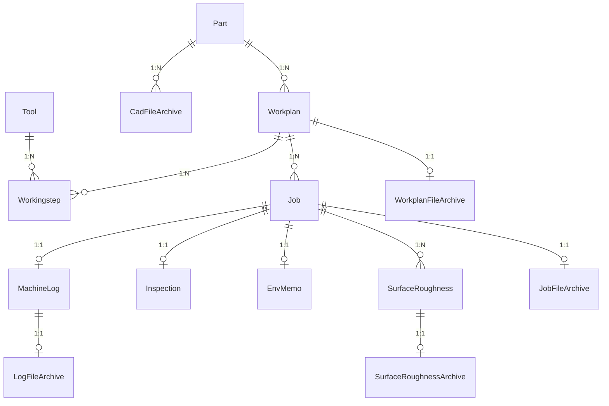

<p align="center">
  
</p>

<h1 align="center">공작기계지능화실험실 통합 제조 데이터베이스 시스템 (ManufacturingDB)</h1>

<p align="center">
  <a href="https://www.python.org/"></a>
  <a href="https://www.mysql.com/"></a>
  <a href="https://www.sqlalchemy.org/"></a>
  <a href="https://streamlit.io/"></a>
  <a href="https://www.iso.org/"></a>
  <a href="https://github.com/OrcusExtreme/ManufacturingDB"></a>
</p>

공작기계지능화실험실(Machine Tool Intelligence Lab)의 **통합 제조 데이터베이스 및 가공 데이터 분석 시스템**입니다.  
공작기계(CNC) 가공 과정에서 발생하는 이기종 데이터(XML 메타데이터, NC 프로그램, 12.8kHz 고주파 NI TDMS 센서 데이터, 1Hz CNC 상태 로그, 표면 조도 프로파일 CSV, 3D CAD 모델)를 Watchdog 기반으로 자동 감시·수집·파싱하여 **ISO 14649(STEP-NC) 표준 기반 RDBMS**에 정규화 적재하고, 분석용 웹 대시보드와 외부 연동용 REST API를 제공합니다.

---

## 주요 기능

### 1. ISO 14649(STEP-NC) 표준 기반 데이터 모델링
- **정적 공정 계획(Static Planning)과 동적 가공 실행(Dynamic Execution)의 분리 설계**
- `Part(부품)` ➔ `Workplan(NC 가공계획)` ➔ `Workingstep(단위공정/공구호출)` ↔ `Tool(공구 마스터)` 구조의 계층형 공정 모델링
- 동일 Workplan 조건에서 반복 수행되는 실험 가공 차수(`Job`)의 1:N 이력 관리

### 2. 스토리지 계층 구조 및 백업 체계
- **MySQL RDBMS**: B-Tree 인덱스 기반 조건 검색, 다차원 조인 및 통계 쿼리 처리
- **Apache Parquet**: 12.8kHz 고주파 시계열 센서 데이터 및 단면 표면조도 곡선을 Snappy 컬럼형 압축 포맷으로 저장 및 시각화
- **File Vault**: 원본 파일의 무결성 보존을 위한 디렉터리 분리 (프로젝트 외부 경로 지정을 통해 소스 변경 시에도 백업 격리)
- **LONGBLOB 이중화**: 덤프 파일 단독 복구를 위해 15MB 이하 주요 원본 파일(XML, NC, CAD 등)을 DB 내 바이너리로 이중 보관
- **초기화 시 보관소 격리**: 데이터베이스 및 런타임 데이터 초기화 시 백업 보관소(`archive_vault`)는 삭제 대상에서 제외

### 3. 실시간 자동 수집 파이프라인
- `machining_raw_data/` 디렉터리 내 신규 파일 유입 시 파일 락(Lock) 해제를 감지하여 자동 파싱 트리거 (Watchdog)
- 자료 유형별 파서 자동 분기 (`XML`, `TDMS`, `NC`, `Log`, `CSV`, `STEP`/`STL`)
- **디렉터리 자동 정돈**: 수집 폴더 내 투입된 파일을 확장자 규칙에 따라 `XML/`, `Log/`, `TDMS/`, `NC/` 하위 디렉터리로 자동 분류 (`backend/job_layout.py`)
- **TDMS 파싱 최적화**: 메모리 가용량 기반의 단일 패스(Single-pass) 읽기와 지연 로딩 전환을 통해 대용량 센서 파일 파싱 속도 개선
- 백그라운드 변환 데몬(`tdms_visualizer.py`)을 통한 시간 도메인 지표 및 FFT 주파수 스펙트럼 Parquet 자동 생성

### 4. 제조 DB Controller (Win32 GUI)
- `system_controller.exe`를 통해 4대 서브프로세스(Streamlit 대시보드, Watchdog 수집기, TDMS 변환기, REST API 서버)의 통합 제어 및 실시간 로그 스트리밍 지원
- 프로세스 재시작 없이 파서 활성화/비활성화 및 파이프라인 일시정지 제어 (`backend/pipeline_config.json`)
- Windows Job Object 기반 프로세스 그룹 관리로 컨트롤러 비정상 종료 시 자식 프로세스 자동 회수
- 외부 스크립트 실행 방식으로 구성되어 파이썬 소스 수정 시 컨트롤러 재컴파일 불필요
- 사용자 관리(가입 승인/거절, 계정 조회/삭제) 및 스토리지 선택적 초기화 GUI 내장

### 5. Streamlit 기반 웹 통합 대시보드 (Port 8501)
- 가공 차수(Job) 다차원 필터링 및 상세 분석 (Plotly 기반 센서 Envelope, FFT, 3D CAD Z-up 뷰어, 표면조도 프로파일)
- 데이터 수동 업로드, 메타데이터/가공환경/품질검사 입력 일원화
- ISO 14649 공정 트리 조회 및 공구 마스터(장착/미장착) 일괄 관리
- 인터랙티브 ERD 기반 테이블 탐색기 및 데이터 드릴다운 ZIP 다운로드 지원
- PBKDF2-HMAC-SHA256 해시 기반 로컬 인증 및 세션 영속화

### 6. 제조 DB REST API 서버 (Port 8000)
- 외부 시스템, 연계 분석 장비 및 AI/LLM 파이프라인 연동을 위한 FastAPI 기반 RESTful 서비스
- **전체 데이터 익스포트 (`GET /api/v1/export/all`)**: 15개 테이블의 전체 가공 및 계측 데이터를 단일 JSON으로 추출
- **계층형 프로필 조회 (`GET /api/v1/jobs/{job_id}/full`)**: 공정 계획, 공구, 로그, 조도, 품질 데이터를 계층 구조의 단일 컨텍스트로 제공
- **OpenAPI / Swagger UI (`http://localhost:8000/docs`)**: 인터랙티브 API 문서 및 스키마 명세 지원

---

## 시스템 아키텍처

제조 DB Controller(`system_controller.exe`)를 통해 4개의 독립 백그라운드 프로세스를 관리합니다. 각 프로세스는 직접적인 프로세스 간 통신(IPC) 대신 데이터베이스와 파일 시스템을 통해 상호 연동됩니다.

```text
┌─────────────────────────────────────────────────────────────────────────────────────────────┐
│  제조 DB Controller  (system_controller.exe · C++ Win32)                                     │
│  · 4대 서브프로세스 기동/중지 · 실시간 통합 로그 · 파서별 활성화 설정 · 일시정지              │
│  · backend/pipeline_config.json (설정 파일 기반 상태 동기화)                                  │
│  · Windows Job Object 기반 자식 프로세스 생명주기 관리                                       │
└────────┬─────────────────────────┬──────────────────────────┬───────────────────────────────┤
         │ 프로세스 제어            │ 프로세스 제어             │ 프로세스 제어                 │ 프로세스 제어
         ▼                         ▼                          ▼                               ▼
  ① Watchdog 수집기         ② TDMS 변환 데몬            ③ Streamlit 대시보드            ④ REST API 서버
                               (5초 폴링)                   (localhost:8501)               (0.0.0.0:8000)

[가공/계측 데이터 투입]
         │
         ▼
   data/machining_raw_data/{Project}/{Part}/
        ├─ CAD_Files/                      ← Part 수준 3D 도면 파일
        └─ {JobID}/ XML · Log · TDMS · NC · Surface_Roughness · etc · processed_parquet
                                          │
                                          ▼
 ① Watchdog 수집기  (data_insert_recognization.py)
    ├─ 파일 안정성 검사 (File Lock 해제 감지)
    ├─ job_layout.py — 확장자 기반 하위 디렉터리 자동 분류
    ├─ pipeline_control.py — 파서 활성화 상태 및 일시정지 플래그 확인
    ├─ 파싱 엔진 [parsers/]
    │    xml · nc · tdms · log · roughness · cad  (+ job_manager · tool_inserter)
    ├─ integrity_monitor — 30분 주기 백그라운드 SHA-256 무결성 검증
    └─ 오류 격리 ─▶ data/failed_data (DLQ)
         │
         ├──▶ MySQL RDBMS (SQLAlchemy ORM)   정규화 데이터 적재
         ├──▶ Archive Vault                  원본 파일 보관소 (프로젝트 외부)
         └──▶ MySQL LONGBLOB                 주요 메타/형상 원본 파일 (15MB 이하)

 ② TDMS 변환 데몬  (tdms_visualizer.py)
    └─ tdms_alignment.py — NC 블록 대조 실가공 구간 판별 및 시간축 정렬, FFT 계산
         ├──▶ Parquet 스토리지
         │      data/processed_data → Job 디렉터리/processed_parquet → Vault
         └──▶ MySQL 메타데이터 업데이트 (tdms_parquet_path, machining_window)

 ③ Streamlit UI (:8501)
    ├─ Read  ◀── MySQL · Parquet 스토리지 · Archive Vault · 원본 디렉터리
    ├─ Write ──▶ MySQL (메타데이터 수정, Cascade 삭제, 공구 마스터 갱신)
    ├─ Write ──▶ raw_data (수동 데이터 삽입 → 수집기 파이프라인 재진입)
    └─ recovery_engine.py ──▶ 복구 ZIP 생성 및 로컬 복원

  ※ 데이터베이스에는 보관소 루트 기준의 상대 경로만 저장되며,
     실제 파일 I/O는 파서, 복구 엔진 및 대시보드 컴포넌트가 파일 시스템을 통해 수행합니다.
```

---

## 데이터베이스 스키마 구조



| 도메인 | 테이블명 | 설명 |
| :--- | :--- | :--- |
| **마스터 & 공정 계획** | `part`, `workplan`, `tool`, `workingstep`, `cad_file_archive` | 부품 마스터, NC 공정 계획(부품·프로그램·NC해시 복합 유니크 제약), 공구 제원(ISO 14649 분류 및 치수, 매거진 장착/재고 관리), 단위 공정 순서 및 절삭 가공 조건(Feed/Spindle), 3D 형상 파일 관리 |
| **가공 실행 & 품질** | `job`, `machine_log`, `surface_roughness`, `inspection`, `env_memo` | 가공 차수 이력(가공 시간, 거리, 에러), CNC 1Hz 부하 통계, 다지점 표면조도 프로파일, 치수공차 판정(PASS/FAIL), 가공 환경 데이터 |
| **아카이브 & 백업** | `workplan_file_archive`, `job_file_archive`, `surface_roughness_archive`, `log_file_archive` | 원본 디렉터리 경로(`*_raw_path`) 및 LONGBLOB 백업 데이터 |

- 원본 파일 경로는 메타데이터 테이블(`job`, `workplan` 등)과 분리하여 아카이브 테이블(`*_archive`)에서 관리합니다.
- 보관소(`archive_vault`)는 원본 디렉터리(`machining_raw_data`)의 상대 경로 구조를 그대로 유지하므로, DB에는 보관소 내부 절대 경로를 저장하지 않고 상대 경로 규칙(`backend/vault_layout.py`)에 따라 조회합니다.
- 파일 조회 및 복원 시 `로컬 원본 경로 ➔ 백업 보관소 ➔ DB 바이너리(BLOB)` 순서의 폴백(Fallback) 구조를 지원합니다.

---

## 디렉터리 구성

```text
ManufacturingDB/
├── system_controller.exe             # 통합 GUI 제어기 (제조 DB Controller)
├── README.md
├── .env                              # 데이터베이스 접속 및 환경 변수 설정
├── .streamlit/config.toml            # Streamlit 서버 설정
├── pyrefly.toml                      # 타입 체커 설정
│
├── assets/                           # 정적 이미지 및 아이콘 자산
│   ├── logo_card.png                 #   컨트롤러 헤더 및 사이드바 카드 로고
│   ├── logo.png / logo.jpg           #   메인 로고
│   └── logo.ico / favicon.ico        #   애플리케이션 및 브라우저 파비콘
│
├── controller/                       # C++ Win32 GUI 소스 코드
│   ├── system_controller.cpp         #   UI 이벤트 및 프로세스 관리 구현
│   ├── theme.h                       #   UI 테마 및 드로잉 헬퍼
│   ├── app_config.h                  #   설정 JSON 입출력 및 파이썬 경로 탐색
│   └── system_controller.rc          #   리소스 명세 (아이콘, 버전 정보)
│
├── backend/                          # 백엔드 및 수집 파이프라인
│   ├── data_insert_recognization.py  #   Watchdog 파일 감시 및 작업 분배기
│   ├── job_layout.py                 #   Job 디렉터리 분류 규칙 (XML, Log, TDMS, NC)
│   ├── vault_manager.py              #   백업 보관소 관리 및 아카이빙 로직
│   ├── vault_layout.py               #   보관소 내부 경로 산출 규칙
│   ├── file_archive.py               #   아카이브 레코드 조회 및 생성
│   ├── job_manager.py                #   Job 레코드 생성 및 검증
│   ├── recovery_engine.py            #   보관소 및 DB 기반 복원 엔진
│   ├── tdms_visualizer.py            #   TDMS Parquet/FFT 변환 백그라운드 데몬
│   ├── tdms_alignment.py             #   NC 블록 대조 가공 구간 판별 및 시간축 정렬
│   ├── tool_inserter.py              #   ISO 14649 공구 마스터 검증 및 일괄 적재
│   ├── pipeline_control.py           #   파이프라인 상태 제어 인터페이스
│   ├── pipeline_config.json          #   파서 활성화 및 일시정지 상태 설정 파일
│   ├── integrity.py                  #   SHA-256 기반 원본 무결성 검증
│   ├── integrity_monitor.py          #   백그라운드 무결성 모니터링 데몬 (30분 주기)
│   ├── auth.py                       #   PBKDF2 기반 계정 인증 및 세션 관리
│   ├── user_manager.py               #   사용자 관리 독립 GUI (tkinter)
│   ├── clean_dummy_data.py           #   미참조 레코드 정리 유틸리티
│   ├── reset_database_and_storage.py #   데이터베이스 및 스토리지 선택적 초기화 CLI
│   ├── reset_manager.py              #   초기화 선택 GUI (tkinter)
│   ├── admin_ui.py                   #   관리 GUI 공통 컴포넌트
│   ├── migrate_*.py                  #   스키마 및 디렉터리 구조 마이그레이션 스크립트
│   ├── normalize_name_casing.py      #   디렉터리 대소문자 표준화 도구
│   ├── DB/
│   │   ├── database.py               #   SQLAlchemy 엔진 및 세션 설정
│   │   ├── models.py                 #   ORM 스키마 정의 (14개 테이블)
│   │   └── schema_patch.py           #   기동 시 스키마 컬럼 보정 패치
│   ├── parsers/                      #   자료 유형별 파서
│   │   ├── xml_parser.py  nc_parser.py  tdms_parser.py
│   │   └── log_parser.py  roughness_parser.py  cad_parser.py
│   └── tests/                        #   단위 테스트 및 시스템 통합 검증 스크립트
│
├── frontend/                         # Streamlit 웹 대시보드
│   ├── dashboard.py                  #   대시보드 메인 진입점
│   ├── cad_viewer_component.py       #   Three.js 기반 3D CAD(STEP/STL) 뷰어
│   ├── erd_component.py              #   인터랙티브 ERD 컴포넌트
│   └── components/                   #   화면별 서브 컴포넌트
│       ├── home_view.py              #   홈 대시보드 화면
│       ├── filters.py                #   다단계 검색 필터
│       ├── job_workspace.py          #   Job 상세 분석 및 관리 화면
│       ├── master_tree.py            #   ISO 14649 공정 계층 트리뷰
│       ├── tool_master.py            #   공구 마스터 조회 및 파일 교체
│       ├── data_upload.py            #   수동 데이터 업로드 화면
│       ├── db_explorer.py            #   DB 테이블 조회 및 편집기
│       ├── download_center.py        #   데이터 일괄 다운로드 센터
│       └── recovery.py               #   백업 생성 및 시스템 복원
│
├── data/                             # 런타임 저장 디렉터리 (Git 추적 제외)
│   ├── machining_raw_data/           #   가공 데이터 감시 디렉터리
│   ├── processed_data/               #   전처리된 Parquet 시계열 데이터
│   └── failed_data/                  #   파싱 실패 격리 디렉터리 (DLQ)
│
├── tools/                            # 개발 및 운영 유틸리티
│   ├── run_system.py                 #   통합 프로세스 일괄 기동 CLI
│   ├── run_api.py / run_api.bat      #   REST API 서버 단독 실행
│   ├── compile_controller.bat        #   C++ 컨트롤러 빌드 스크립트
│   ├── run_controller.bat            #   컨트롤러 실행 스크립트
│   ├── run_windows.bat               #   가상환경 구성 및 통합 실행 배치 파일
│   └── requirements.txt              #   파이썬 의존성 패키지 명세
│
├── installer/                        # 배포 패키지(Inno Setup) 빌드 환경
│   ├── build_installer.py            #   설치 패키지 빌드 자동화 스크립트
│   ├── ManufacturingDB.iss           #   Inno Setup 스크립트
│   ├── setup_target.py               #   설치 후 초기 구성 스크립트
│   └── requirements-runtime.txt      #   배포용 동봉 파이썬 패키지 명세
│
└── docs/                             # 기술 문서 및 표준 데이터
    ├── gemini.md                     # 시스템 아키텍처 상세 기술 명세
    ├── tool_iso14649.csv             # 공구 마스터 초기 표준 데이터
    ├── tool_iso14649_schema.sql      # Tool 테이블 DDL 스키마
    └── tool_iso14649_sources.md      # 공구 제원 출처 및 실물 대조 문서
```

---

## 시작하기

> **참고**: 배포 대상 장비에 전체 환경을 일괄 구축하려면 [배포용 설치 패키지](#배포용-설치-패키지-setupexe)를 사용할 수 있습니다. 아래 가이드는 개발 환경 설정 기준입니다.

### 1. 요구 사항
- **Python**: 3.10 이상
- **MySQL**: 8.0 이상
- **OS**: Windows 10 / 11 (C++ Win32 컨트롤러 구동 환경)
  - 타 OS 환경에서는 CLI 기반 실행(`python tools/run_system.py`)을 지원합니다.
- **g++ (MinGW-w64 / w64devkit)**: 컨트롤러 C++ 소스 재컴파일 시 필요

### 2. 저장소 복제 및 가상환경 설정
```bash
git clone https://github.com/OrcusExtreme/ManufacturingDB.git
cd ManufacturingDB

# 가상환경 생성 및 패키지 설치
python -m venv .venv
.venv\Scripts\activate
pip install -r tools/requirements.txt
```

### 3. 환경 변수 설정 (`.env`)
프로젝트 루트 디렉터리에 `.env` 파일을 생성하고 데이터베이스 및 스토리지 경로를 설정합니다.

```env
DB_HOST=localhost
DB_PORT=3306
DB_USER=root
DB_PASSWORD=your_password
DB_NAME=orcus
PYTHONPATH=backend

# 원본 백업 보관소 외부 경로 지정 (권장)
ORCUS_VAULT_ROOT=D:\Orcus\archive_vault
```

#### 원본 백업 보관소 외부 지정 정책
프로젝트 디렉터리 재설치나 코드 변경 시에도 수집된 원본 데이터의 보존성을 확보하기 위해, 백업 보관소(`archive_vault`)는 프로젝트 외부 디렉터리로 분리 지정하는 것을 권장합니다.

| 우선순위 | 환경 변수 | 설명 |
| :--- | :--- | :--- |
| 1 | `ORCUS_VAULT_ROOT` | 백업 보관소 절대 경로 직접 지정 |
| 2 | `ORCUS_DB_DATA_DIR` | 지정된 경로 하위의 `archive_vault/` 디렉터리 사용 |
| 3 | (미지정) | 기본 내부 경로 `data/archive_vault` 사용 |

기존 보관소 디렉터리 이전 시 아래 마이그레이션 스크립트를 사용할 수 있습니다.

```bash
python backend/migrate_vault_location.py            # 변경 예정 내역 미리보기
python backend/migrate_vault_location.py --apply    # 실제 이동 적용 (복사 ➔ 검증 ➔ 원본 정리)
```

> ⚠️ **주의**: 백업 보관소를 MySQL 데이터 디렉터리 내부(예: `.../Data/orcus`)로 설정하지 마십시오. 데이터베이스 삭제(`DROP DATABASE`) 시 스키마 디렉터리 전체가 제거되어 보관소 데이터가 함께 유실될 수 있습니다. 반드시 별도의 디렉터리 경로를 지정하십시오.

### 4. 시스템 실행

#### 방법 1: 제조 DB Controller 실행 (권장)
```bash
system_controller.exe          # 실행 파일 직접 실행
# 또는
tools\run_controller.bat       # 실행 파일 부재 시 자동 컴파일 후 실행
```
- Win32 네이티브 컨트롤러를 통해 Streamlit UI, 수집 파이프라인, TDMS 변환기, REST API 서버의 개별 시작/중지 및 통합 로그 모니터링을 지원합니다.
- 컨트롤러 메뉴의 `유저 관리`에서 대시보드 회원가입 요청의 승인/거절 및 계정 관리를 수행할 수 있습니다 (`backend/user_manager.py`).

*컨트롤러 수정 후 재빌드 (MinGW g++ 필요):*
```bash
tools\compile_controller.bat
```

#### 방법 2: CLI 터미널 일괄 실행
```bash
python tools/run_system.py
```

*개별 서비스 단독 실행:*
```bash
# REST API 서버 단독 실행 (Port 8000)
tools\run_api.bat              # 또는 python tools/run_api.py
```

### 5. 서비스 접속 정보
- **통합 웹 대시보드**: [http://localhost:8501](http://localhost:8501)
- **REST API Swagger 문서**: [http://localhost:8000/docs](http://localhost:8000/docs) (ReDoc: `/redoc`, OpenAPI 스펙: `/openapi.json`)
- **컨트롤러 대시보드**: `system_controller.exe` 창을 통해 4개 서브프로세스 상태 및 로그 확인

---

## 배포용 설치 패키지 (Setup.exe)

타 장비(작업장 PC, 계측 서버 등)에 별도의 파이썬 및 MySQL 설치 없이 일괄 배포할 수 있는 인스톨러 빌드 환경(`installer/`)을 제공합니다.

### 1. 패키지 설치 절차 (배포 대상 PC)
1. 생성된 `Setup_ManufacturingDB_v*.exe`를 관리자 권한으로 실행합니다.
2. **설치 디렉터리**(기본값: `D:\ManufacturingDB`)와 **데이터 디렉터리**(기본값: `D:\Orcus`)를 지정합니다.
3. 데이터베이스 모드를 선택합니다:
   - **동봉된 MySQL 8.0 설치**: 전용 윈도우 서비스(`OrcusMySQL`)로 자동 등록 및 설정됩니다.
   - **기존 MySQL 인스턴스 연동**: 기설치된 MySQL 8.0 인스턴스의 포트와 root 계정 정보를 입력하여 연동합니다.
4. 설치 완료 후 생성된 바탕화면 바로가기 또는 `system_controller.exe`를 실행하고 **[전체 시작]**을 클릭합니다.
5. 웹 대시보드 접속 후 계정 가입 신청을 진행하고, 컨트롤러의 **[유저 관리]** 창에서 해당 계정을 승인합니다.

### 2. 설치 패키지 빌드 (개발 PC)
Inno Setup 6 및 로컬 MySQL 8.0 서버가 구성된 환경에서 아래 스크립트를 통해 단일 설치 파일을 빌드할 수 있습니다.

```bat
python installer\build_installer.py           # dist/Setup_ManufacturingDB_v*.exe 생성
python installer\build_installer.py --test    # 로컬 테스트용 경량 빌드
```

---

## 대시보드 주요 기능 안내

1. **홈 화면**: 시스템 상태 요약 및 주요 기능에 접근할 수 있는 바로가기 그리드를 제공합니다.
2. **Job 워크스페이스**:
   - 프로젝트, 부품, 가공차수, 실험일자, 장비 기준의 5단계 캐스케이딩 필터를 통한 가공 데이터 검색
   - 시간 도메인 Envelope, 주파수 FFT 스펙트럼, 1Hz CNC 로그 추이, 단면 표면조도 프로파일 시각화
   - 불필요 가공 데이터 삭제 시 하위 연관 레코드의 원자적 연쇄 삭제(`CASCADE`) 지원
3. **계층형 마스터 데이터**:
   - ISO 14649 기반 공정 계층(`Part ➔ Workplan ➔ Workingstep ➔ Tool`) 탐색
   - 단위 공정별 절삭 가공 조건(주축 회전수 RPM, 이송속도 mm/min) 및 Part별 3D CAD(STEP/STL) 뷰어 지원
4. **공구 마스터 관리**:
   - ISO 14649 규격 기반 공구 제원(치수, 날 수, 재질, 장착 상태) 관리
   - 표준 CSV 템플릿 다운로드 및 수정본 업로드를 통한 공구 마스터 일괄 갱신
5. **데이터 삽입**:
   - 3D 형상 모델, XML, NC, TDMS, Log, 표면조도 CSV 웹 수동 업로드 인터페이스
   - 업로드 시점에 가공 분류, 환경 데이터(온습도, 작업자, 이상 소음 등), 품질 점검(치수공차, 합불 판정) 동시 입력
6. **DB 테이블 탐색기**:
   - 인터랙티브 ERD 연동 테이블 실시간 조회, 다중 조건 필터링, 컬럼 정렬 및 CSV 내보내기
   - 데이터 무결성 보호를 위해 테이블 직접 수정 시 관리자 인증 절차 적용
7. **데이터 다운로드 센터**:
   - 프로젝트 및 가공 차수 단위의 계층형 선택 및 ZIP 일괄 압축 다운로드
   - 원본 디렉터리 내 파일 누락 시 백업 보관소 및 DB 아카이브 자동 폴백 지원
8. **백그라운드 무결성 모니터링**:
   - 수집 파이프라인 구동 중 30분 주기로 주요 원본 파일의 SHA-256 해시를 재계산하여 데이터 무결성을 검증합니다 (`backend/integrity_monitor.py`).

---

## 릴리즈 노트 (Release Notes)

### [V3.1.0] - 2026-10-09
- **제조 DB REST API 서버 신설 (FastAPI 기반, Port 8000)**:
  - 외부 연구 시스템 및 LLM 파이프라인 연동을 위한 RESTful API 엔드포인트 구축 ([`backend/api/`](backend/api))
  - 전체 DB 일괄 덤프(`GET /api/v1/export/all`) 및 단일 가공 차수 컨텍스트 프로필(`GET /api/v1/jobs/{job_id}/full`) API 제공
  - Swagger UI(`/docs`), ReDoc(`/redoc`) 및 OpenAPI 표준 스펙(`/openapi.json`) 연동
  - CORS 전면 지원 및 직렬화 시 민감 정보 필터링 적용
- **제조 DB Controller 4대 프로세스 통합 관리**:
  - `system_controller.exe`에 REST API 서버 모듈을 추가하여 4개 서브프로세스 일괄 제어 지원
  - 8000번 포트 충돌 사전 검사 및 컨트롤러 창 레이아웃 최적화
- **공구 마스터 및 초기화 관리 고도화**:
  - 공구 마스터 스키마를 ISO 14649 표준 규격으로 전면 정규화 (`docs/tool_iso14649.csv`, `backend/tool_inserter.py`)
  - 데이터베이스 및 스토리지 항목별 선택적 초기화 GUI(`backend/reset_manager.py`) 신설
- **올인원 배포 인스톨러 빌드 환경 구축**:
  - Inno Setup 기반 배포 스크립트(`installer/build_installer.py`)를 통해 파이썬 런타임 및 MySQL 8.0 무인 자동 설치 지원

### [V3.0.6] - 2026-09-30
- **웹 대시보드 인증 및 세션 영속화**:
  - PBKDF2-HMAC-SHA256 해시 기반 사용자 인증 체계 적용
  - 대시보드 가입 신청 및 컨트롤러 GUI를 통한 가입 승인/거절 기능 제공
  - 브라우저 쿠키 연동을 통한 세션 유지 및 로그인 사용자 작업자명 자동 연계
- **백업 보관소 상대 경로 미러 구조 전환**:
  - 보관소(`archive_vault`) 구조를 원본 디렉터리와 동일한 상대 경로 체계로 단순화 (`backend/vault_layout.py`)
  - DB 대리키 의존성을 배제하여 DB 초기화 상태에서도 보관소 기반 원본 복원 지원
  - 보관소 복원 유틸리티(`backend/restore_from_vault.py`) 및 컨트롤러 복원 메뉴 연동
- **공구 코드 표준화 및 매칭 로직 개선**:
  - 공구 코드 표준 표기(`T01`~`T99`) 정규화 및 정수형 공구 번호(`tool_number`) 기반 매칭 일원화
- **가공 환경 및 품질 데이터 입력 워크플로우 일원화**:
  - 메타데이터, 환경 정보, 품질 점검 입력을 '데이터 삽입' 업로드 화면으로 통합

### [V3.0.5] - 2026-09-16
- **백업 보관소 외부 분리 및 보호 정책 수립**:
  - 데이터베이스 삭제 시 보관소 동시 유실을 방지하기 위해 보관소 기본 위치를 MySQL 스키마 디렉터리 외부로 분리
  - 원본과 보관소의 물리 디스크 분리 가이드 반영
- **시스템 아키텍처 다이어그램 및 파이프라인 표기 최신화**:
  - 수집기, TDMS 변환 데몬, Streamlit, 컨트롤러 간의 실제 프로세스 경계 및 Parquet 스토리지 계층 명확화

### [V3.0.4] - 2026-09-15
- **TDMS 변환 파이프라인 성능 최적화**:
  - 단일 패스 읽기(`TdmsFile.read`) 도입을 통해 채널별 중복 파일 스캔 병목 해소 (대용량 파일 기준 파싱 속도 대폭 개선)
  - 파싱 안정성을 위한 `BufferedReader` 적용 및 메모리 상태에 따른 지연 로딩 자동 폴백 지원
- **디렉터리 대소문자 표준화**:
  - Windows 및 MySQL 환경의 대소문자 비구분 특성에 따른 경로 분기 방지를 위해 DB 등록 명칭(`canonical_names`) 기준 경로 통일
- **Watchdog 감시 필터링 안정화**:
  - 시스템 임시 파일 무시 기준 통일 및 삭제 이벤트 큐 워커 처리를 통한 커넥션 풀 고갈 방지

### [V3.0.0 ~ V3.0.3] - 2026-09-14 ~ 09-15
- 프로젝트 디렉터리 구조 기능별 분리 (`backend/`, `frontend/`, `controller/`, `tools/`, `docs/`, `assets/`)
- C++ Win32 네이티브 컨트롤러 신설 및 Streamlit 대시보드 홈 화면 개편
- 백업 보관소 위치 이전 도구(`migrate_vault_location.py`) 및 스토리지 초기화 안전 보호 장치 도입

### [V2.0.0 ~ V2.3.5] - 2026-08-31 ~ 09-14
- ISO 14649(STEP-NC) 표준 데이터베이스 스키마 확립
- Watchdog 기반 무중단 수집 파이프라인 및 백업 보관소/LONGBLOB 이중화 체계 구현
- TDMS-Parquet 변환기, 표면조도 파서, 3D CAD(STEP/STL) 뷰어 및 재난 복구 모듈 개발

---

## 라이선스 및 문의

- **개발 및 관리**: 공작기계지능화실험실 (Machine Tool Intelligence Lab)
- **GitHub**: [@OrcusExtreme](https://github.com/OrcusExtreme)
- **Issues**: 기능 개선 및 버그 리포트는 [GitHub Issues](https://github.com/OrcusExtreme/ManufacturingDB/issues)를 이용해 주시기 바랍니다.
